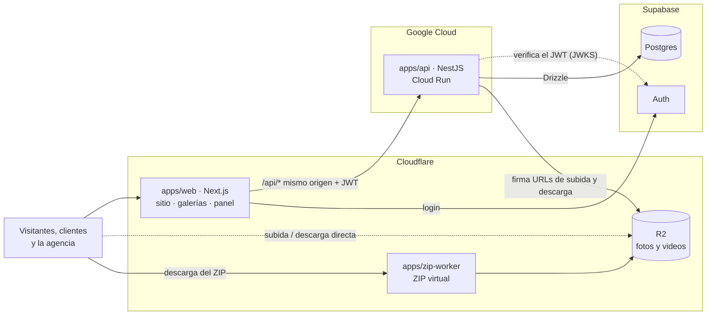

# Focal Drop

[](https://github.com/Rurbis/focaldrop/actions/workflows/ci.yml)

[English](README.md) · **Español**

Plataforma multi-tenant para agencias de fotografía. Cada agencia tiene su propio sitio público y entrega fotos y videos a sus clientes en galerías privadas que vencen a los 30 días.

> **En construcción.** Estamos en el hito 0 (fundaciones). El primer cliente es una agencia de fotografía en México, así que la interfaz está en español (es-MX); el código y los README están en inglés y los documentos de diseño, en español.

## Qué hace

| Función                                                                                                                  | Hito         |
| ------------------------------------------------------------------------------------------------------------------------ | ------------ |
| Panel de la agencia, con inicio de sesión                                                                                | 0 (en curso) |
| Galerías privadas: subida de archivos grandes directo al almacenamiento, links que vencen, descargas en calidad original | 1            |
| Descarga de la galería completa como ZIP armado al vuelo, reanudable y nunca guardado                                    | 1            |
| Sitio público de cada agencia: tema con _design tokens_, portafolio, paquetes y contacto                                 | 2            |
| Lanzamiento en el dominio de la agencia                                                                                  | 3            |

Cada hito termina con algo que la agencia puede usar de verdad ([hitos y alcance](docs/phase-1c-scope-and-closing.md)).

## Arquitectura



- **Next.js renderiza, NestJS decide.** El navegador solo habla con Next, y Next reenvía `/api/*` a Nest en el mismo origen, así que no hay CORS. Toda regla de negocio, permiso y filtro por agencia vive en Nest.
- **Los archivos nunca pasan por un servidor.** Nest firma URLs temporales de R2 y el navegador sube y descarga directo: los videos grandes no gastan tiempo de servidor y R2 no cobra la salida.
- **Multi-tenant desde el día uno:** una sola base de datos con `agency_id` en todas las tablas, y la agencia se resuelve por el dominio de la petición. RLS está activo en todas las tablas desde el inicio, y las políticas por agencia llegan antes que la segunda agencia.
- **Planes gratuitos por diseño, con tope real de gasto:** la API escala a cero y un corte automático desconecta la facturación si se supera el presupuesto mensual ([`infra/gcp`](infra/gcp/README.md)).

Diseño completo: [arquitectura](docs/phase-1a-architecture.md) · [datos y usuarios](docs/phase-1b-data-and-users.md) · [metodología](docs/phase-2-methodology.md).

## Stack

| Capa                  | Elección                                                                               |
| --------------------- | -------------------------------------------------------------------------------------- |
| Front                 | Next.js 16 (App Router), React 19, Tailwind CSS 4, TypeScript                          |
| API                   | NestJS en Google Cloud Run (`us-east4`)                                                |
| Base de datos y auth  | Supabase Postgres + Supabase Auth; Drizzle ORM con migraciones SQL versionadas         |
| Archivos y ZIP        | Cloudflare R2 con URLs prefirmadas; Cloudflare Worker para el ZIP virtual              |
| Contratos compartidos | Esquemas Zod en `@focaldrop/shared`, validados en el navegador, en Nest y en el Worker |
| Monorepo y CI         | pnpm workspaces, Turborepo, GitHub Actions, Workload Identity Federation (sin llaves)  |
| Calidad               | ESLint con información de tipos, Prettier, Vitest, Husky + lint-staged                 |
| Monitoreo             | Sentry y UptimeRobot                                                                   |

## Estructura del repo

```text
apps/
  web/            Front en Next.js (hoy el panel; después el sitio y las galerías)
  api/            API en NestJS                   (en curso)
  zip-worker/     Worker de Cloudflare para el ZIP (hito 1)
packages/
  shared/         Esquemas Zod, tipos y constantes compartidos por todas las apps
infra/
  gcp/            Script de arranque de Google Cloud y corte automático de facturación
docs/             Bitácora de decisiones y documentos de diseño
.github/          Workflow de CI, plantillas de issues y PRs, Dependabot
```

## Cómo empezar

**Requisitos:** Git, Node.js 24.22.1 o una 24.x posterior (ver `.nvmrc`), pnpm 10.34.6 y Docker Desktop con el motor Linux arrancado.

```bash
npm install -g pnpm@10.34.6
git clone https://github.com/Rurbis/focaldrop.git
cd focaldrop
pnpm install --frozen-lockfile
```

Puede que pnpm termine con un recuadro que dice que ignoró los scripts de compilación de `esbuild`. Es normal: nada en el repo los necesita.

Sigue la [guía de Supabase local](infra/supabase/README.md) para arrancar la pila y generar `infra/supabase/.env.local`, ignorado por Git. Copia `apps/api/.env.example` a `apps/api/.env` si todavía no existe; si ya existe, añade las variables de BD sin sobrescribir los valores actuales. Los valores de ejemplo ya apuntan a la pila local:

- Bash: `cp -n apps/api/.env.example apps/api/.env`
- PowerShell: `if (-not (Test-Path apps/api/.env)) { Copy-Item apps/api/.env.example apps/api/.env }`

Después ejecuta:

```bash
pnpm db:migrate
pnpm db:seed
pnpm dev
```

Los comandos raíz `db:generate`, `db:migrate`, `db:seed` y `db:reset` compilan
`@focaldrop/shared` antes de cargar el esquema, incluso en un clon nuevo.

El panel corre en http://localhost:3000/admin y la API en http://localhost:3001/health. El seed local crea la agencia `demo`, el dominio `localhost` y el owner `owner@focaldrop.test` con contraseña `Focaldrop-local-only-2026!`. Son credenciales sintéticas solo para Docker local; el login del panel se implementa en la #18. La [guía de la BD](apps/api/README.md#local-demo-issue-15) explica el reset y las pruebas de integración.

## Comandos

Se corren desde la raíz del repo. Turborepo ejecuta cada tarea en las apps y paquetes que la tengan, compilando primero las dependencias.

| Comando                             | Qué hace                                                    |
| ----------------------------------- | ----------------------------------------------------------- |
| `pnpm dev`                          | Levanta todas las apps en modo desarrollo                   |
| `pnpm build`                        | Compila todas las apps y paquetes                           |
| `pnpm lint`                         | ESLint, con información de tipos                            |
| `pnpm typecheck`                    | Revisión de tipos de TypeScript                             |
| `pnpm test`                         | Pruebas (Vitest)                                            |
| `pnpm db:start` / `pnpm db:stop`    | Supabase local en Docker                                    |
| `pnpm db:migrate`                   | Aplica las migraciones versionadas de Drizzle               |
| `pnpm db:seed`                      | Crea o reutiliza la agencia demo y su owner                 |
| `pnpm db:reset`                     | Borra los datos de Supabase local, migra y siembra de nuevo |
| `pnpm format` / `pnpm format:check` | Prettier                                                    |

## Despliegues

El front se despliega a Cloudflare Workers desde GitHub Actions ([`deploy-web.yml`](.github/workflows/deploy-web.yml)). Cada PR que lo toca recibe su propia preview (`pr-<número>`), enlazada desde el PR, y cada mezcla a `main` despliega staging. OpenNext solo genera un Worker que funciona en Linux, así que siempre se compila en la CI (D129, D137); en Windows se usa `pnpm dev`.

- **Staging:** https://focaldrop-web-staging.focaldrop.workers.dev
- **Previews de los PRs:** `https://pr-<número>-focaldrop-web-staging.focaldrop.workers.dev`
- **Supabase de staging** está en el plan gratuito, que pausa un proyecto tras una semana sin actividad en la BD. [`keep-supabase-awake.yml`](.github/workflows/keep-supabase-awake.yml) hace una consulta diaria para mantenerlo activo.

## Cómo contribuir

- **Ramas cortas** desde `main` (`feat/`, `fix/`, `chore/`, `docs/`, `ci/`, `spike/`) y **Conventional Commits** con _scope_: `feat(web): add login page`.
- Todo cambio entra por **pull request** con el checklist de la plantilla. Lo revisa la otra persona, los checks `quality` y `test` deben pasar, y el autor lo mezcla con **squash** después de la aprobación.
- Issues y PRs se escriben en español; títulos, commits y código, en inglés.
- La bitácora se actualiza en el mismo PR que el cambio que registra.

## Documentación

Los documentos de diseño viven en [`docs/`](docs/):

- [Bitácora](docs/project-log.md): todas las decisiones (D1–D134), pendientes, supuestos, glosario e historial.
- [Arquitectura](docs/phase-1a-architecture.md), [datos y usuarios](docs/phase-1b-data-and-users.md), [alcance y cierre](docs/phase-1c-scope-and-closing.md) y [metodología](docs/phase-2-methodology.md).
- Los [ADRs](docs/adr/README.md) (_Architecture Decision Records_).
- [Plan de diseño del front](docs/design/plan.md): cómo se diseñan el sitio público, la galería del cliente y el panel para que nunca se vean genéricos.

## Estado

Hito 0, fundaciones. Listo: monorepo, CI, paquete compartido y cuentas en la nube. En curso: esqueletos de la web y de la API, esquema de la base de datos, inicio de sesión y los primeros despliegues a staging. El avance se sigue en el [tablero del proyecto](https://github.com/users/Rurbis/projects/1).

## Licencia

© 2026 The Focal Drop authors. Todos los derechos reservados. Este repositorio es público como proyecto de portafolio; no se otorga licencia para usar, copiar, modificar ni distribuir el código.
