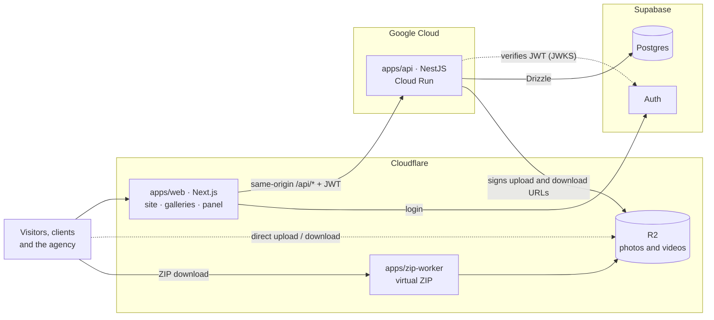

# Focal Drop

[](https://github.com/Rurbis/focaldrop/actions/workflows/ci.yml)

**English** · [Español](README.es.md)

Multi-tenant platform for photography agencies. Each agency gets its own public website, and delivers photos and videos to its clients through private galleries that expire after 30 days.

> **Work in progress.** Building milestone 0 (foundations). The first client is a photography agency in Mexico, so the interface is in Spanish (es-MX); code and docs for developers are in English, design docs in Spanish.

## What it does

| Feature                                                                                                  | Milestone       |
| -------------------------------------------------------------------------------------------------------- | --------------- |
| Admin panel for the agency, with login                                                                   | 0 (in progress) |
| Private galleries: upload of large files straight to storage, expiring links, original-quality downloads | 1               |
| Whole-gallery download as a ZIP built on the fly, resumable, never stored                                | 1               |
| Public website per agency: theme from design tokens, portfolio, packages, contact                        | 2               |
| Launch on the agency's own domain                                                                        | 3               |

Each milestone ends with something the agency can actually use ([milestones and scope](docs/phase-1c-scope-and-closing.md)).

## Architecture



- **Next.js renders, NestJS decides.** The browser only talks to Next; Next forwards `/api/*` to Nest on the same origin, so there is no CORS. Every business rule, permission check and tenant filter lives in Nest.
- **Files never pass through a server.** Nest signs short-lived R2 URLs and the browser uploads and downloads directly, so large videos cost no server time and R2 charges no egress.
- **Multi-tenant from day one:** one shared database with `agency_id` on every table, and the agency resolved from the request's host name. Row Level Security is on for every table from the start, and per-agency policies arrive before a second agency does.
- **Free tiers by design, with a hard spending cap:** the API scales to zero, and a billing guard disables billing if the monthly budget is exceeded ([`infra/gcp`](infra/gcp/README.md)).

Full design: [architecture](docs/phase-1a-architecture.md) · [data and users](docs/phase-1b-data-and-users.md) · [methodology](docs/phase-2-methodology.md).

## Stack

| Layer             | Choice                                                                                  |
| ----------------- | --------------------------------------------------------------------------------------- |
| Front             | Next.js 16 (App Router), React 19, Tailwind CSS 4, TypeScript                           |
| API               | NestJS on Google Cloud Run (`us-east4`)                                                 |
| Database and auth | Supabase Postgres + Supabase Auth; Drizzle ORM with versioned SQL migrations            |
| Files and ZIP     | Cloudflare R2 with presigned URLs; Cloudflare Worker for the virtual ZIP                |
| Shared contracts  | Zod schemas in `@focaldrop/shared`, validated in the browser, in Nest and in the Worker |
| Monorepo and CI   | pnpm workspaces, Turborepo, GitHub Actions, Workload Identity Federation (no keys)      |
| Quality           | ESLint with type information, Prettier, Vitest, Husky + lint-staged                     |
| Monitoring        | Sentry and UptimeRobot                                                                  |

## Repository structure

```text
apps/
  web/            Next.js front (panel today; site and galleries next)
  api/            NestJS API                      (in progress)
  zip-worker/     Cloudflare Worker for ZIPs      (milestone 1)
packages/
  shared/         Zod schemas, types and constants shared by every app
infra/
  gcp/            Google Cloud bootstrap script and billing guard
docs/             Decision log and design documents (Spanish)
.github/          CI workflow, issue and PR templates, Dependabot
```

## Getting started

**Prerequisites:** Git, Node.js 24 (see `.nvmrc`), pnpm 10.34.6 and Docker Desktop with the Linux engine running.

```bash
npm install -g pnpm@10.34.6
git clone https://github.com/Rurbis/focaldrop.git
cd focaldrop
pnpm install --frozen-lockfile
```

Follow the [local Supabase guide](infra/supabase/README.md) to start the stack and generate its ignored `infra/supabase/.env.local`. Copy `apps/api/.env.example` to `apps/api/.env` if that file does not exist; otherwise add its database settings without overwriting existing values. Then run:

```bash
pnpm db:migrate
pnpm db:seed
pnpm dev
```

The root `db:generate`, `db:migrate`, `db:seed` and `db:reset` commands build
`@focaldrop/shared` before loading the database schema, including in a fresh clone.

The panel runs at http://localhost:3000/admin and the API at http://localhost:3001/health. The local seed creates agency `demo`, domain `localhost` and owner `owner@focaldrop.test` with password `Focaldrop-local-only-2026!`. These synthetic credentials are for local Docker only; panel login is implemented in #18. See the [database guide](apps/api/README.md#local-demo-issue-15) for reset and integration tests.

## Commands

Run from the repository root; Turborepo runs each task in every app and package that has it, building dependencies first.

| Command                             | What it does                                      |
| ----------------------------------- | ------------------------------------------------- |
| `pnpm dev`                          | Starts every app in development mode              |
| `pnpm build`                        | Builds every app and package                      |
| `pnpm lint`                         | ESLint, with type information                     |
| `pnpm typecheck`                    | TypeScript checks                                 |
| `pnpm test`                         | Test suites (Vitest)                              |
| `pnpm db:start` / `pnpm db:stop`    | Local Supabase in Docker                          |
| `pnpm db:migrate`                   | Apply versioned Drizzle migrations                |
| `pnpm db:seed`                      | Create or reuse the local demo and owner          |
| `pnpm db:reset`                     | Erase local Supabase data, migrate and seed again |
| `pnpm format` / `pnpm format:check` | Prettier                                          |

## Contributing

- **Short-lived branches** from `main` (`feat/`, `fix/`, `chore/`, `docs/`, `ci/`, `spike/`) and **Conventional Commits** with a scope: `feat(web): add login page`.
- Every change goes through a **pull request** with the template's checklist. The other person reviews it, the `quality` and `test` checks must pass, and the author **squash-merges** after approval.
- Issues and pull requests are written in Spanish; titles, commits and code in English.
- The decision log is updated in the same pull request as the change it records.

## Documentation

Design documents live in [`docs/`](docs/) (in Spanish):

- [Project log](docs/project-log.md): every decision (D1–D134), pending items, assumptions, glossary and history.
- [Architecture](docs/phase-1a-architecture.md), [data and users](docs/phase-1b-data-and-users.md), [scope and closing](docs/phase-1c-scope-and-closing.md) and [methodology](docs/phase-2-methodology.md).
- [Architecture Decision Records](docs/adr/README.md).
- [Front-end design plan](docs/design/plan.md): how the public site, client gallery and admin panel are designed so they never look generic.

## Status

Milestone 0, foundations. Done: monorepo, CI, shared package and cloud accounts. In progress: web and API skeletons, database schema, login and the first deployments to staging. Progress is tracked on the [project board](https://github.com/users/Rurbis/projects/1).

## License

© 2026 The Focal Drop authors. All rights reserved. This repository is public as a portfolio project; no license is granted to use, copy, modify or distribute the code.
