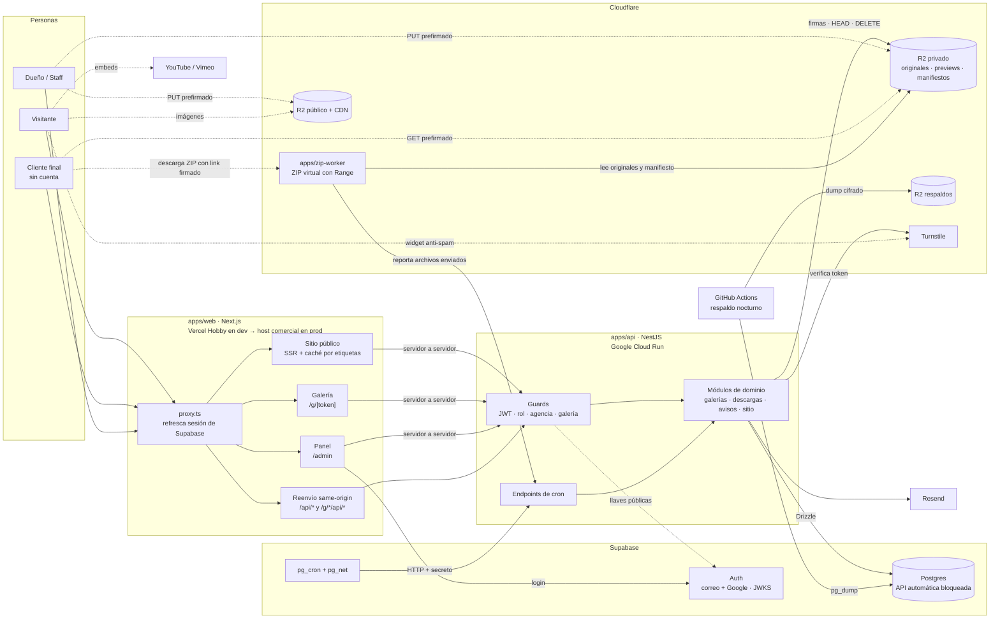
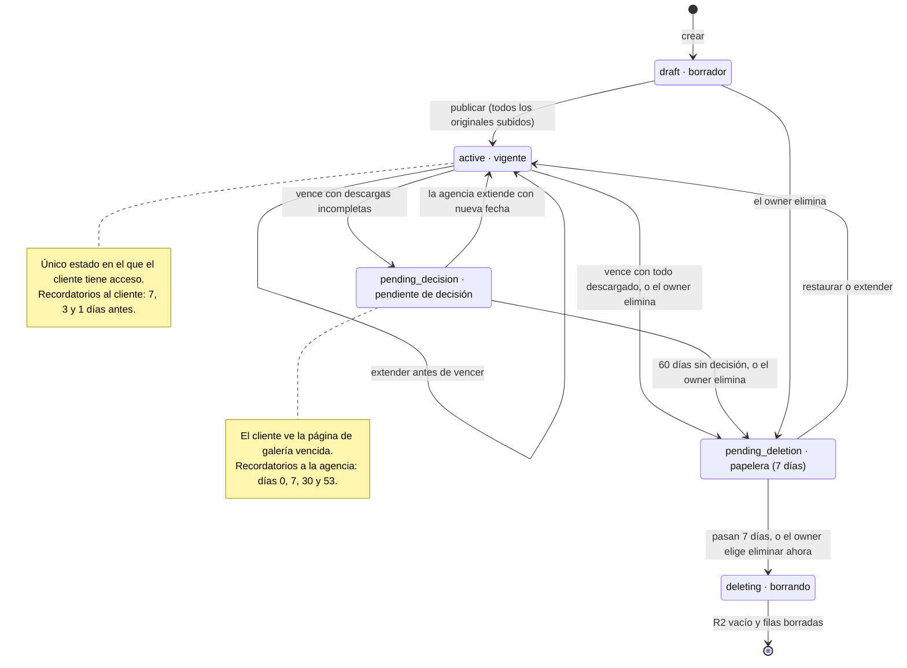
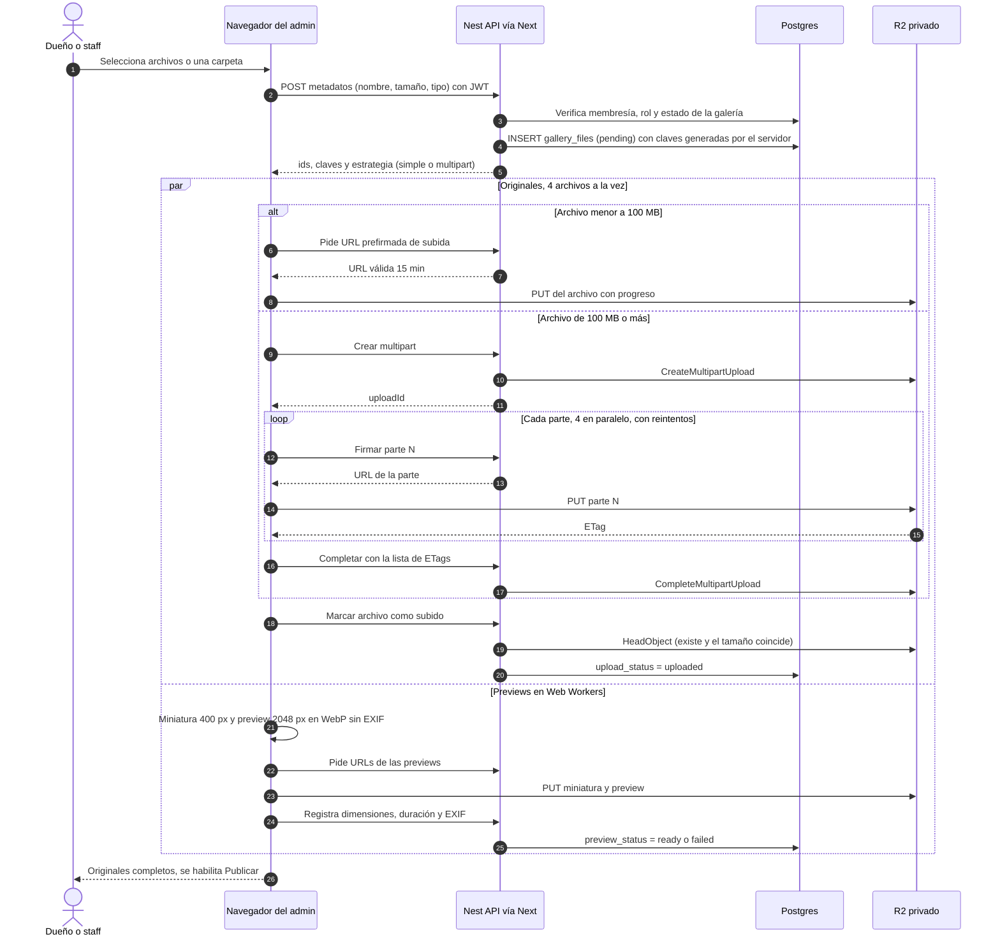
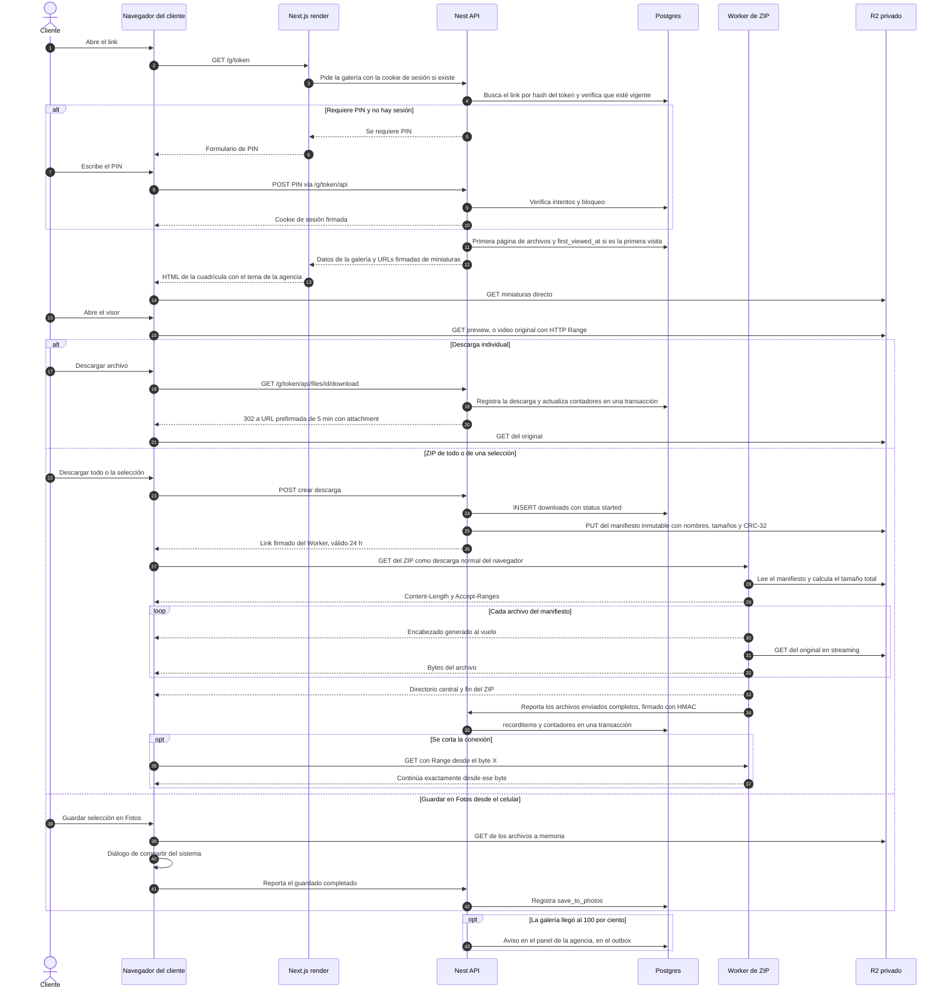
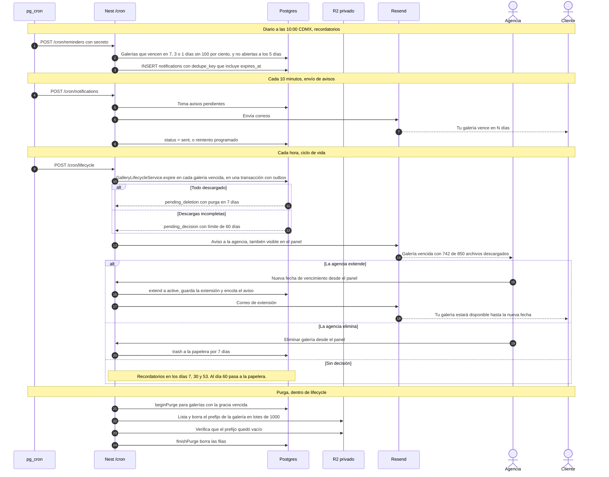

# Fase 1 · Parte A: Arquitectura

- **Versión:** v3.1 · 2026-10-11
- **Estado:** ✅ aprobada por el equipo (v3 el 2026-10-09; ajustes de la v3.1 el 2026-10-11)
- **Relacionado:** [project-log.md](project-log.md): contexto, registro de decisiones (D#) y pendientes.

> **Cambios en la v3.1 (revisión de alcance del 2026-10-11, D82–D90).** El diseño no cambia; cambia **cuánto de él entra al MVP y en qué orden** (Parte C). S-4 pasa al hito 0 y Cloudflare es el host del front por defecto (D83). El Worker de ZIP se construye por etapas y se corrigen los límites del plan Free (D84). El sitio público v1 lleva el layout en código (D85). Nueva §3.14: observabilidad, protección de costos y cuentas (D86–D88). Cambios en §3.1, §3.4, §3.9, §5, §6 y §7.
>
> **Cambios en la v3.** El ZIP ya no se arma en el navegador del cliente. Ahora lo compone **al vuelo un Cloudflare Worker** junto a R2 (D65), con reanudación por Range, sin almacenamiento extra y siempre al día. Para eso, el navegador de la agencia calcula el CRC-32 de cada archivo al subirlo (D66). Salen del MVP el Service Worker y `client-zip`. Se revisaron D44 y D53, y cambiaron P2, §2, §3.1, §3.5, §3.8, §3.9, §3.12, §4.3 y §5.
>
> **Cambios en la v2.** Se incorporó **NestJS** como API (D56–D64):
> - la lógica de negocio vive en servicios de Nest con transacciones de Drizzle, en lugar de funciones SQL;
> - el aislamiento entre agencias se aplica en código, con RLS por agencia antes del SaaS;
> - la API automática de Supabase queda bloqueada;
> - el cron llama a Nest;
> - el navegador le habla a Next y Next reenvía las llamadas a Nest;
> - la API se hospeda en Cloud Run.
>
> Los principios, el manejo de archivos, las previews, el ZIP, los estados y los avisos no cambian.

## Índice

1. [Principios de arquitectura](#1-principios-de-arquitectura)
2. [Vista general](#2-vista-general)
3. [Evaluación por tema](#3-evaluación-por-tema)
4. [Diagramas de ciclo de vida y secuencia](#4-diagramas-de-ciclo-de-vida-y-secuencia)
5. [Spikes para la Fase 3](#5-spikes-para-la-fase-3)
6. [Decisiones de esta parte](#6-decisiones-de-esta-parte)
7. [Fuentes](#7-fuentes)

---

## 1. Principios de arquitectura

Cinco ideas guían todas las decisiones. Si una decisión futura contradice alguna, hay que justificarlo explícitamente.

| # | Principio | Por qué |
|---|---|---|
| P1 | **Los archivos nunca pasan por nuestros servidores.** Next y Nest solo autorizan y firman; el navegador habla directo con R2 (o con el Worker de ZIP, que vive junto a R2). | Las funciones y contenedores tienen límites de tamaño y tiempo, y su ancho de banda cuesta. R2 y los Workers no cobran egress. |
| P2 | **El trabajo pesado se hace donde no cuesta.** Las previews se generan en el navegador de la agencia, que ya tiene los archivos. El ZIP lo compone un Worker dentro de la red de Cloudflare, junto a R2, donde mover bytes no se cobra. | Procesar medios en nuestros servidores costaría cómputo, y moverlos fuera de Cloudflare costaría tráfico. |
| P3 | **La base de datos es la fuente de verdad; el almacenamiento la sigue.** | Las decisiones (vencer, borrar) dependen de datos que solo la BD conoce. R2 solo guarda bytes. |
| P4 | **Nada de la agencia en el código.** Nombre, marca, textos y diseño son configuración en la BD. | El nombre cambiará y el producto será multi-tenant. |
| P5 | **Código portable.** Nada exclusivo de un host; servicios usados por APIs estándar (S3, SQL, HTTP, contenedores). | El host del front se elige al lanzar (D1), y la API es un contenedor que corre en cualquier lugar. |

**Reparto de responsabilidades (D56):** **Next.js renderiza; NestJS decide.**
- **Next** se encarga de la presentación, el SEO, la caché de páginas y la sesión del panel.
- **Nest** concentra las reglas de negocio, el acceso a datos, los permisos, las firmas de R2, los avisos y el cron.

---

## 2. Vista general

### 2.1 Diagrama de arquitectura



Las líneas punteadas son tráfico **directo entre el navegador y un servicio externo**. Los bytes pesados nunca tocan Next ni Nest (P1). El ZIP viaja de R2 al cliente a través del Worker, todo dentro de la red de Cloudflare, sin cobro de tráfico.

*El Worker reporta su avance a un endpoint interno de Nest (protegido con HMAC); en el diagrama se agrupa con los endpoints de cron porque comparte su forma de protección.*

### 2.2 Componentes y responsabilidades

| Componente | Responsabilidad | No hace |
|---|---|---|
| `proxy.ts` (Next) | Refrescar la cookie de sesión de Supabase en `/admin`. | Consultar datos: tiene que ser rápido. |
| Sitio público (Next, Server Components) | Pedir a Nest la configuración y el contenido, renderizar y cachear por etiquetas. | Reglas de negocio. |
| Galería `/g/[token]` (Next) | Renderizar la cuadrícula y el visor con los datos que entrega Nest. | Validar el acceso: lo hace Nest. |
| Panel `/admin` (Next) | Interfaz del panel; invalidar la caché del sitio después de guardar. | Escribir en la BD directamente. |
| Reenvío same-origin (Next) | Mandar a Nest las llamadas que hace el navegador (Uppy, acciones del visor, creación de descargas), para que todo quede en un mismo origen sin CORS y con cookies propias. | Lógica de negocio. |
| Guards (Nest) | Verificar el JWT (JWKS), la membresía, el rol y la agencia; verificar la sesión de la galería del cliente. | — |
| Módulos de dominio (Nest) | Toda la lógica de negocio y los datos (§2.4). | Servir bytes. |
| Endpoints de cron e internos (Nest) | Ejecutar los jobs por lotes y recibir el avance que reporta el Worker de ZIP; protegidos con secreto / HMAC. | — |
| `apps/zip-worker` (Cloudflare) | Verificar el link firmado, leer el manifiesto y componer el ZIP al vuelo desde R2, con soporte de Range. Reportar a Nest qué archivos terminó de enviar. | Tocar la BD ni decidir permisos: solo obedece al link firmado y al manifiesto que preparó Nest. |
| Postgres (Supabase) | Fuente de verdad. API automática bloqueada (D60). | Ser accedida por el navegador. |
| Supabase Auth | Identidad: contraseñas, Google, recuperación, invitaciones. | Permisos de negocio: los decide Nest. |
| `pg_cron` + `pg_net` | Disparar los jobs llamando por HTTP a Nest. | Ejecutar la lógica. |
| R2 | Guardar bytes en tres buckets: privado, público y respaldos (D50). | Decidir cuándo borrar (P3). |
| Resend | Entregar correos. | Decidir cuándo enviarlos: eso lo hace el outbox. |

### 2.3 Mapa de rutas (D38, D62)

**En Next (lo que ve el navegador):**

| Ruta | Quién | Tema | Acceso | Caché |
|---|---|---|---|---|
| `/`, `/portafolio`, `/portafolio/[categoria]`, `/paquetes`, `/contacto`, `/privacidad` | Visitante | Agencia | Público | Sí, por etiquetas |
| `/blog`, `/blog/[slug]` (Should) | Visitante | Agencia | Público | Sí |
| `/g/[token]` | Cliente | Agencia | Token (+ PIN), lo valida Nest | No |
| `/admin/login`, `/admin/...` | Dueño / Staff | **Neutro de la plataforma** (D39) | Supabase Auth + rol, lo valida Nest | No |
| `/api/*` → Nest | Panel (llamadas desde el navegador, p. ej. Uppy) | — | JWT | No |
| `/g/[token]/api/*` → Nest | Galería (visor, descarga individual, creación del ZIP, Guardar en Fotos) | — | Cookie de sesión de la galería | No |

**En Nest:**

| Prefijo | Para quién | Protección |
|---|---|---|
| `/admin/*` | Panel | JWT + membresía + rol |
| `/public/*` | Sitio público y resolución del tenant | Ninguna (solo datos publicados) + límite por IP donde aplique |
| `/public/galleries/:token/*` | Galería del cliente | Token + sesión de galería (cookie firmada) |
| `/cron/*` | `pg_cron` | `Authorization: Bearer <CRON_SECRET>` |
| `/internal/downloads/:id/progress` | Worker de ZIP | Firma HMAC con secreto compartido |

**En el Worker de ZIP:**

| Ruta | Para quién | Protección |
|---|---|---|
| `zip.<dominio>/z/:downloadId?exp=…&sig=…` (en desarrollo: `*.workers.dev`) | Cliente (descarga normal del navegador) | Firma HMAC emitida por Nest, con expiración de 24 h. Se revoca al borrar el manifiesto. |

Las rutas públicas de Next van en español (son contenido y cuentan para el SEO); las del panel y las de Nest, en inglés. Los endpoints de la galería viven bajo `/g/[token]/api/*` para que su cookie pueda limitarse a esa ruta (D43).

### 2.4 Módulos de Nest (preliminar)

Cada módulo corresponde a un área del negocio. Este mapa es útil para explicar la arquitectura en una entrevista, y es la base de las épicas del backlog en la Fase 2.

| Módulo | Responsabilidad |
|---|---|
| `auth` | Validar el JWT de Supabase con JWKS; cargar la membresía y el rol. |
| `tenancy` | Resolver la agencia por host; guardar el contexto de agencia de la petición (AsyncLocalStorage, vía `nestjs-cls`). |
| `agencies` | Agencia, dominios, miembros, invitaciones, preferencias. |
| `site` | Tema, secciones, páginas legales, testimonios, FAQ, blog (Should). |
| `portfolio` | Categorías e ítems del portafolio. |
| `packages` | Paquetes y precios. |
| `contact` | Solicitudes de contacto (Turnstile, límite por IP). |
| `clients` | Clientes y destinatarios. |
| `galleries` | Galerías y su **máquina de estados**: publicar, vencer, extender, papelera, purga. |
| `uploads` | Firmas de subida simple y multipart; verificación con `HeadObject`. |
| `gallery-access` | Token, PIN, sesión del cliente, listado de archivos, URLs de lectura. |
| `downloads` | Registro de descargas y contadores de avance. Prepara el manifiesto del ZIP en R2, firma el link del Worker y recibe su avance. |
| `notifications` | Outbox + un *provider* por canal (`email`, `in_app`, `whatsapp` en el futuro). |
| `storage` | Cliente S3 de R2: **el único lugar con credenciales de R2**. |
| `cron` | Endpoints de los jobs. |

---

## 3. Evaluación por tema

### 3.1 Hosting y límites de los planes gratuitos

| Servicio y plan | Límite relevante | Impacto para nosotros | Si se excede |
|---|---|---|---|
| Vercel Hobby (front) | **Solo uso no comercial** | La primera galería real de la agencia ya es uso comercial. Por eso S-4 pasa al hito 0 y Cloudflare es la opción por defecto (D83); Vercel Hobby queda como respaldo solo para desarrollo. | Riesgo de suspensión → se migra antes de la primera galería real. |
| Vercel Hobby | 1M invocaciones, 4 h de CPU activa, 100 GB de transferencia al mes | Holgado: los archivos no pasan por Vercel. | No se puede comprar uso extra. |
| Vercel Hobby | Colaboración solo en repos públicos | Resuelto con D6. | Se bloquean los deploys del colaborador. |
| **Google Cloud Run** (API) | 2M requests, 180k vCPU-segundos y 360k GiB-segundos al mes; 1 GB de egress en Norteamérica; pide tarjeta | Holgado: ~100 ms de CPU por request. El egress es JSON paginado. | Cobro por uso (centavos a este volumen). |
| Cloud Run | **Escala a cero** | Arranque en frío de 1–3 s tras un rato inactivo. El job de avisos (cada 10 min) lo mantiene despierto casi siempre. El sitio público está cacheado en Next, así que no despierta a Nest en cada visita. | Si molesta: una instancia siempre encendida ≈ **US$8–10/mes (excepción)**. |
| Artifact Registry | 0.5 GB gratis para imágenes de contenedor | Imágenes pequeñas + borrado automático de las viejas. | Centavos por GB. |
| Supabase Free | 500 MB de BD | Solo metadatos: ≈ 30 MB al año a 15 galerías/mes, y se libera al borrar galerías. | La BD pasa a solo lectura. |
| Supabase Free | 5 GB de egress | Consultas de Nest, paginadas. Estimado < 1 GB/mes. | Restricción o cobro. |
| Supabase Free | Pausa tras 7 días sin actividad | En producción, los cron de Nest generan actividad continua. En desarrollo se reactiva a mano. | Sitio caído hasta restaurarlo. |
| Supabase Free | Sin backups automáticos | D4: respaldo propio nocturno. | Pérdida de datos. |
| Supabase Free | 2 proyectos activos | Producción + uno compartido para desarrollo y previews. Cada quien trabaja en local con la CLI. *(Se decide en la Fase 2.)* | — |
| R2 | 10 GB-mes, 1M ops Clase A, 10M ops Clase B, egress $0 | El almacenamiento se excede al lanzar (centavos). Las operaciones quedan holgadas. | US$0.015/GB-mes · US$4.50/M Clase A · US$0.36/M Clase B. |
| Resend Free | 3,000/mes · **100/día** · 1 dominio | ~210/mes estimados. | **El envío se pausa.** El dispatcher se frena en 90/día y difiere el resto. |
| GitHub Actions | Minutos ilimitados en repos públicos | CI, build de la imagen de la API, respaldo nocturno. | — |
| Turnstile | Gratis | Formulario de contacto. | — |
| Cloudflare Workers Free (front, D83) | 100k req/día · 10 ms de CPU por petición · 3 MiB de bundle · **sin restricción de uso comercial** | Next solo renderiza y el sitio público va cacheado, así que es plausible que quepa. El panel (SSR dinámico) es lo que más CPU usa. Se mide en S-4, en el hito 0. | Workers Paid (US$5/mes), que cubriría también el Worker de ZIP. |
| **Cloudflare Workers** (Worker de ZIP, D65, D84) | Free: 10 ms de CPU por petición, **1,000 lecturas internas a R2** y 50 subrequests externos por petición. Paid (US$5/mes): 30 s de CPU (hasta 5 min) y 10,000 subrequests por defecto. Ningún plan limita la duración mientras el cliente siga conectado. | Free cubre galerías de hasta ~1,000 archivos por petición. La CPU solo corre al armar encabezados y copiar bytes, así que **es plausible que Free alcance también en producción**: S-2 lo mide. Paid es condicional, no un gasto asumido. | Errores por CPU o subrequests → Paid, que cubriría también el front si va a Cloudflare. |

### 3.2 Resolución del tenant (B3, D40)

**En Next:**
1. `proxy.ts` solo refresca la sesión de Supabase en `/admin`. No consulta datos.
2. En el servidor, `getAgencyByHost(host)` le pide la agencia a Nest (`GET /public/tenant`) enviando `X-Tenant-Host`. La respuesta se cachea con la etiqueta `agency-domains`, que se invalida al editar dominios.
3. Si el host no está registrado:
   - **fuera de producción**, se usa `DEFAULT_AGENCY_SLUG` (D7);
   - **en producción**, 404.

**En Nest:**
- Un *middleware* lee `X-Tenant-Host`, resuelve la agencia (caché en memoria de 5 min) y la guarda en el contexto de la petición (AsyncLocalStorage).
- Todo el código de esa petición la lee del contexto, sin pasarla por parámetros.

**Seguridad.** El host solo define el **contexto público**: qué sitio mostrar. Alguien podría llamar a Cloud Run directamente con un `X-Tenant-Host` falso, pero solo obtendría datos que ya son públicos. Los permisos del panel salen del **JWT + membresía**: el guard verifica que el usuario sea miembro de la agencia de ese host, con el rol necesario.

**Futuro (dejar preparado):** subdominios `{slug}.<plataforma>` (una fila más en `agency_domains`), dominios propios (Vercel Domains API o Cloudflare for SaaS), y el panel del SaaS en `app.<plataforma>` con selector de agencia.

### 3.3 Multi-tenancy y aislamiento entre agencias (B2, D59, D60)

Tres capas, construidas por etapas:

| Capa | Qué es | Cuándo |
|---|---|---|
| **0 · BD cerrada** | RLS activado en **todas** las tablas, sin políticas para `anon` ni `authenticated`. La API REST automática de Supabase no expone nada. Nest se conecta con su propio rol `app_api`, que tiene una política "todo permitido". | **MVP** |
| **1 · Aislamiento en código** | `AuthGuard` (JWT) → `TenantGuard` (membresía en la agencia del contexto) → `RolesGuard` (`@Roles('owner')`). **Repositorios con filtro obligatorio**: ningún método consulta sin `agencyId`, que sale del contexto y nunca del body de la petición. Tests e2e en los que un usuario de la agencia A intenta leer o modificar recursos de B y debe recibir 404. | **MVP** |
| **2 · RLS por agencia** | Cada petición corre en una transacción que ejecuta `set_config('app.agency_id', …)`. Las políticas de `app_api` pasan de "todo permitido" a `agency_id = current_setting('app.agency_id')::uuid`. Si un repositorio olvidara el filtro, Postgres lo bloquea igual. | **Antes de dar de alta la segunda agencia** (es requisito del SaaS) |

**Por qué por etapas.** Con una sola agencia no hay datos ajenos que proteger, así que la capa 2 solo añadiría complejidad. La migración a la capa 2 está prevista desde el diseño: solo se cambian las políticas de `app_api` y se agrega un interceptor que abre la transacción.

**Por qué 404 y no 403** al intentar acceder a recursos de otra agencia: así no se revela que el recurso existe.

**Caminos sin usuario (cliente final y cron).** El contexto de agencia se deriva del recurso (`gallery.agency_id`) y se usan **los mismos repositorios**. No hace falta un camino especial que se salte las reglas.

### 3.4 Themeability (B4, D39)

> **Alcance v1 (D85).** La primera versión lleva **el orden de las secciones fijo en código**, en una sola plantilla. Lo que sí vive en la BD desde el hito 2: tema (colores, fuentes, radios), textos e imágenes de cada sección, contacto, redes y SEO. El registro `type` + `variant`, las versiones borrador/publicado y la verificación WCAG se construyen cuando una segunda agencia necesite otro layout. El resto de esta sección describe el diseño objetivo.

- **Tokens → CSS variables.** El layout raíz del sitio y de la galería imprime en el `<head>`, **renderizado en el servidor**, un bloque `:root { --color-primary: …; … }` con el tema que entrega Nest. No hay "parpadeo" de estilos. En Tailwind v4, `bg-primary` ya compila a `var(--color-primary)`.
- **Validación.** El tema se valida con un esquema Zod de `packages/shared`: Nest lo valida al guardar y Next al leer. Si es inválido, se usa el tema por defecto: **un tema roto nunca tumba el sitio**.
- **Al guardar** se derivan las escalas de tono (50–900) y se avisa si el contraste no cumple WCAG AA (Should).
- **Fuentes.** Catálogo de ~8–10 fuentes con `next/font`; el tema elige `heading` y `body` por clave. Solo se precargan las elegidas.
- **Secciones.** Un registro mapea `type` + `variant` → componente React + esquema Zod de props. Los tipos desconocidos se ignoran.
- **Caché del sitio público.** Next cachea con etiquetas (`agency:{id}:site`, `agency:{id}:portfolio`, …). Al guardar, el panel llama a Nest y, si responde bien, Next ejecuta `revalidateTag`. Resultado: cambios inmediatos y **casi ninguna llamada a Nest por visita**, lo que también evita arranques en frío.
- **Panel con diseño neutro (D39).** Experiencia consistente para cualquier agencia, un tema roto no afecta al panel, y no hay que probar el panel con N temas.
- **Correos** con logo y color primario de la agencia.
- **Dejar preparado:** `template_key`, `variant` y versiones borrador/publicado de la configuración.

### 3.5 Subida de archivos grandes (B6, D12, D13)

**Por qué presignar:** ni Vercel (body de 4.5 MB) ni Cloud Run (32 MiB por request) aceptan archivos de varios GB, y además pagaríamos su ancho de banda (P1).

**Flujo** (diagrama §4.2):

1. El admin selecciona archivos o una carpeta.
2. Uppy envía los **metadatos** a `/api/uploads/*`, y Next los reenvía a Nest.
3. El módulo `uploads` valida:
   - el JWT, la membresía y el rol;
   - el estado de la galería (`draft` o `active`);
   - el tamaño máximo por archivo (S6: 50 GB).
4. Nest crea las filas `gallery_files` con `upload_status = pending` y **las claves de almacenamiento las genera el servidor**, nunca el cliente.
5. Cada archivo sube directo a R2 por una de dos vías:
   - **simple:** `PUT` con URL prefirmada;
   - **multipart:** crear → firmar partes → subir partes → completar.
6. **En paralelo**, un Web Worker calcula el **CRC-32** del archivo leyéndolo del disco local de principio a fin (D66). Lo necesita el ZIP virtual (§3.9). Leer del disco es mucho más rápido que subir por internet, así que no retrasa la subida.
7. Al terminar, Nest hace `HeadObject` en R2 para **verificar que el objeto existe y que su tamaño coincide**. Solo entonces marca `uploaded`, con el CRC-32 guardado en `gallery_files.crc32`.
8. La galería solo puede publicarse cuando todos los originales están `uploaded`.

**Valores iniciales** (se calibran en el spike S-5):

| Parámetro | Valor inicial |
|---|---|
| Umbral para usar multipart | 100 MB |
| Tamaño de parte | 16–64 MiB (R2 exige partes del mismo tamaño salvo la última; mínimo 5 MiB) |
| Archivos en paralelo | 4 |
| Partes en paralelo por archivo | 4 |
| Validez de la URL de subida | 15 min (se pide otra al reintentar) |
| Reintentos | Backoff exponencial: 1 s, 2 s, 4 s, 8 s, 16 s → `failed` |

**Librería: Uppy** (`@uppy/aws-s3`) con interfaz propia. Nest implementa los endpoints de firma. Se valida en S-5.

**Claves en R2** (bucket privado):

```text
agencies/{agencyId}/galleries/{galleryId}/originals/{fileId}
agencies/{agencyId}/galleries/{galleryId}/thumbs/{fileId}.webp
agencies/{agencyId}/galleries/{galleryId}/previews/{fileId}.webp
agencies/{agencyId}/galleries/{galleryId}/posters/{fileId}.webp
```

Con el ID no hay colisiones; el nombre original vive en la BD; **borrar una galería = borrar un prefijo**.

**CORS del bucket privado** (por entorno):
- `AllowedOrigins`: los orígenes de la app (Next).
- Métodos: `GET`, `PUT`, `HEAD`.
- `AllowedHeaders`: los que usa Uppy.
- `ExposeHeaders: ETag`: indispensable para completar el multipart.
- `MaxAge: 3600`.

CORS no es la barrera de seguridad, la firma sí. Aun así, en producción se restringe al dominio real.

**Subidas abandonadas.** Hay dos redes de seguridad:
- la regla de ciclo de vida de R2 aborta los multipart incompletos a los 7 días (D49);
- el job `lifecycle` limpia las filas `pending` con más de 7 días.

**Integridad.** Verificación de tamaño con `HeadObject` y validación de partes por R2. El CRC-32 lo calcula el navegador de la agencia (D66), porque en subidas multipart R2 solo ofrece un CRC-32 "compuesto" por partes, que no es el que exige el formato ZIP.

### 3.6 Generación de previews (D9, D52)

*Sin cambios respecto a la v1: todo ocurre en el navegador del admin. Nest solo firma las URLs y registra los metadatos.*

**Pipeline por archivo:**

1. **Clasificar el tipo** por extensión: `image`, `raw`, `heic`, `gif`, `video` u `other`.
2. **Extraer metadatos:** dimensiones, duración, EXIF (→ JSONB) y `taken_at` (columna propia, para ordenar).
3. **Generar las versiones de vista**, aplicando la orientación EXIF: miniatura de **400 px** (~30–60 KB) y preview de **2048 px** (~300–600 KB), ambas en WebP con calidad ~0.8.
4. **Quitar los metadatos.** Las previews salen del canvas **sin metadatos**: protege el GPS. El original conserva su EXIF intacto.
5. **Subir y registrar** las previews y actualizar `preview_status`.

| Tipo | Herramienta | Dónde corre |
|---|---|---|
| JPG / PNG / WebP | `createImageBitmap` + `OffscreenCanvas` | Web Worker (4 en paralelo) |
| GIF | Ídem, con el primer cuadro; el visor muestra el GIF original | Web Worker |
| HEIC | Nativo en Safari; **libheif (WASM)** en el resto, cargado solo si hace falta | Web Worker (2 en paralelo) |
| RAW | **LibRaw (WASM)** extrae el JPEG incrustado; si no trae, ícono | Web Worker (2 en paralelo) |
| Video | `<video>` + canvas en el segundo 1; si el códec no se decodifica, ícono | Hilo principal |
| Otros | Ícono por tipo | — |

**Regeneración.** "Regenerar previews" funciona aunque ya no esté el archivo local: el navegador descarga el original desde R2 (egress gratis) y repite el pipeline.

**Volumen.** Para 1,000 archivos, las previews suman ~450 MB, alrededor del 5 % de la galería.

### 3.7 Visualización en la galería

**Cuadrícula**
- Paginada en Nest (100 archivos por página, con cursor) y virtualizada en el cliente.
- Orden por `taken_at` y luego por nombre. *(Propuesta; reordenar a mano queda como Could.)*

**URLs de miniaturas cacheables.** Nest firma con una **fecha de firma redondeada a la hora** (`signingDate`) y validez de 2 h. Dentro de esa hora la URL es idéntica entre renders y el navegador reutiliza la imagen. Las previews se suben con `Cache-Control: private, max-age=86400`.

**Visor**
- Navegación con teclado y gestos táctiles.
- Precarga de las previews vecinas.

**Video**
- `<video preload="metadata" poster=…>` con URL prefirmada del original, válida **6 h**.
- Si el navegador no puede reproducirlo: "descárgalo para verlo".

**Banner de días restantes**, calculado desde `expires_at` en la zona horaria de la agencia.

**Primera apertura.** La primera visita fija `first_viewed_at` y genera un aviso en el panel (D33).

### 3.8 Registro de descargas (D21, D44, D61)

**El problema.** Una URL prefirmada demuestra que la descarga **empezó**, no que **terminó**.

**Definición de "descargado" (D44).** Un archivo cuenta como descargado si ocurrió **al menos uno** de estos eventos:

| Vía | Evento que se registra | Qué demuestra | Limitación |
|---|---|---|---|
| Individual | Nest emitió la URL prefirmada del original (`single`) | Que se **inició** la descarga | Cuenta aunque se cancele. Lo mitiga la gracia de 7 días (D14). |
| ZIP (todo o selección) | El Worker de ZIP terminó de enviar todos los bytes de ese archivo y lo reportó a Nest | Que los bytes **salieron** de nuestro lado hacia el cliente. Es una señal del servidor: el cliente no puede falsificarla. | Enviado no garantiza recibido si la conexión cae en el último instante. Con Range, un archivo partido entre dos peticiones cuenta cuando se envía su último byte. |
| Guardar en Fotos | El diálogo de compartir se resolvió con éxito | Que el usuario **completó** la acción | Solo en navegadores compatibles. |

**Cálculo eficiente del avance.** `DownloadsService.recordItems(downloadId, fileIds)` es el único punto de entrada: lo invocan la descarga individual, el reporte del Worker de ZIP y "Guardar en Fotos". Corre en **una transacción de Drizzle**:
1. Inserta los `download_items`.
2. Ejecuta `UPDATE gallery_files SET first_downloaded_at = now() WHERE id = ANY($ids) AND first_downloaded_at IS NULL RETURNING id`. El número de filas devueltas es exactamente cuántos archivos se descargaron **por primera vez**.
3. Suma ese número a `galleries.downloaded_file_count`. Un archivo nunca se cuenta dos veces, aunque se descargue diez veces.
4. Si se llegó al 100 %, inserta el aviso en el outbox, dentro de la misma transacción.

"742 de 850" se lee directamente de `downloaded_file_count` / `file_count`. **Total de descargas** = `galleries.download_count`, el número de acciones, desglosado por tipo en el panel.

**Detalles**
- **Descarga individual:** `GET /g/[token]/api/files/[id]/download` → Nest registra el evento → 302 a una URL prefirmada de **5 min** con `Content-Disposition: attachment; filename*=UTF-8''<nombre original>`. Se valida en el spike si R2 respeta `response-content-disposition`; si no, se fija como metadato al subir.
- **Privacidad:** IP como HMAC + user agent. Se borran con la galería.

### 3.9 Descarga en ZIP: ZIP virtual en un Worker (D20, D65, D66)

**Por qué no en el navegador del cliente (la antigua D45).** Armar un ZIP sin compresión casi no usa CPU, así que la potencia del equipo no era el problema. Los problemas reales eran tres:
1. compatibilidad dudosa en Safari/iOS;
2. imposibilidad de reanudar una descarga cortada;
3. dependencia de que la página siga viva, algo frágil en celulares.

Las alternativas de **pregenerar** el ZIP se descartaron (detalle en la bitácora, D65): duplican el almacenamiento, quedan desactualizadas tras cada cambio o cuestan tráfico de salida.

**La idea.** Un ZIP sin compresión es esta secuencia:

```text
[encabezado 1][bytes del archivo 1][encabezado 2][bytes del archivo 2] … [directorio central][fin]
```

Los encabezados son pequeños y solo dependen del nombre, el tamaño, la fecha y el CRC-32 de cada archivo. Si esos datos se conocen de antemano, se puede calcular **el tamaño total exacto y la posición de cada byte** sin leer ningún archivo. Por eso el ZIP nunca se guarda: el Worker lo compone mientras lo envía. Es la técnica de `mod_zip` de NGINX.

**Flujo** (diagrama §4.3)

1. El cliente toca "Descargar todo" o "Descargar selección". La página llama a Nest (`POST /g/[token]/api/downloads`).
2. Nest valida la sesión, crea la fila `downloads` (`zip_all` o `zip_selection`) y escribe el **manifiesto** en R2, en `agencies/{a}/galleries/{g}/manifests/{downloadId}.json`.
   - El manifiesto es la lista ordenada de archivos: clave en R2, nombre dentro del ZIP, tamaño, CRC-32 y fecha.
   - Es **inmutable**, así que todas las peticiones de esa descarga ven exactamente el mismo ZIP.
3. Nest devuelve un link firmado: `zip.<dominio>/z/{downloadId}?exp=…&sig=…`. La firma es un HMAC con un secreto que comparten Nest y el Worker; el link vence en 24 h.
4. La página navega a ese link. Desde aquí **es una descarga normal del navegador**: el dispositivo del cliente no procesa nada y funciona igual en cualquier equipo.
5. El Worker:
   - verifica la firma y la expiración;
   - lee el manifiesto (si ya no existe, responde **410**: la descarga fue revocada);
   - calcula el layout;
   - responde con `Content-Length` (tamaño exacto), `Accept-Ranges: bytes`, `ETag` (el id de la descarga) y `Content-Disposition: attachment; filename*=UTF-8''<titulo-de-la-galeria>.zip`.
6. Para cada archivo genera su encabezado y transmite sus bytes **directo desde R2** (`bucket.get` en streaming). Al final envía el directorio central.
7. Cada ~50 archivos, y al terminar o cortarse la conexión, el Worker reporta a Nest qué archivos envió completos (`POST /internal/downloads/:id/progress`, firmado con HMAC). Nest ejecuta `recordItems` (§3.8). El reporte final usa `ctx.waitUntil`, que deja al Worker terminar ese trabajo aunque el cliente ya se haya ido.

**Reanudación con peticiones Range**

- Si la conexión cae en el byte X, el navegador pide `Range: bytes=X-` con `If-Range: <ETag>`.
- El Worker busca en el layout qué parte contiene ese byte: un encabezado, un archivo o el directorio central.
- Envía el resto de esa parte (si es un archivo, con `bucket.get` y rango) y sigue normalmente.

Esto solo funciona si el layout es **idéntico** entre peticiones. Por eso el manifiesto es inmutable y el CRC-32 se conoce de antemano: es justo la condición que exige `mod_zip` para soportar Range.

**Formato del ZIP**
- Método `stored` (sin compresión): JPG, HEIC, RAW y MP4 ya vienen comprimidos.
- CRC-32 y tamaños en el encabezado local, sin "data descriptor", para que el layout sea determinista.
- ZIP64 solo cuando haga falta: archivo ≥ 4 GiB, desplazamiento ≥ 4 GiB o más de 65,535 entradas.
- Nombres en UTF-8 (bit 11), para que acentos y ñ se vean bien en Windows y macOS.
- Fecha de cada entrada: `taken_at`, o la de subida si no la hay.
- Nombres duplicados con sufijo ` (2)`. Estructura plana, sin carpetas.

**De dónde salen los CRC-32 (D66).** Los calcula el navegador de la agencia al subir (§3.5). R2 no sirve aquí: en subidas multipart solo ofrece un CRC-32 "compuesto" por partes, que no es el que exige el formato ZIP.

**Etapas de construcción (D84).** Un byte fuera de lugar corrompe el ZIP, así que la complejidad entra en orden:

1. **Etapa 1 (hito 1):** streaming con `Content-Length` exacto, método `stored`, nombres UTF-8, sin *data descriptor*. Sin Range ni ZIP64: galerías de hasta 4 GiB y 65,535 archivos. Si una galería excede el límite, el botón ofrece la descarga individual y se registra el caso para priorizar la etapa 2. Pruebas: `unzip -t` y `7z t` sobre un conjunto de muestra, y apertura en Windows, macOS, iOS y Android.
2. **Etapa 2:** peticiones Range con `If-Range` y ZIP64. Pruebas de dos mitades concatenadas y de archivos > 4 GiB.

El layout determinista se diseña desde la etapa 1 porque es el requisito de las dos.

**Límites y costo**

| Concepto | Detalle |
|---|---|
| Plan Free | 10 ms de CPU por petición, **1,000 lecturas internas a R2** y 50 subrequests externos por petición. Cubre galerías de hasta ~1,000 archivos. Como el Worker casi no calcula (los CRC-32 ya vienen de la BD), es plausible que alcance en producción: S-2 mide la CPU por cada 100 archivos. |
| Plan Paid (US$5/mes, **condicional**) | 30 s de CPU por petición (configurable hasta 5 min) y 10,000 subrequests por defecto. La CPU solo corre mientras el código trabaja, no mientras espera la red. Solo si S-2 muestra que Free no alcanza, o si el front en Cloudflare lo requiere (D83): una sola suscripción cubre ambos. |
| Almacenamiento extra | Solo los manifiestos (KB). |
| Lecturas a R2 | Operaciones Clase B (US$0.36 por millón): despreciables. |

**Seguridad**
- El link solo sirve para esa descarga, vence en 24 h y no se puede alterar sin invalidar la firma (HMAC).
- Cuando la galería sale de `active` (vence o va a la papelera), Nest borra su prefijo `manifests/`, y **todos sus links dejan de funcionar al instante** (410).
- `X-Robots-Tag: noindex` y `Cache-Control: private, no-store`.
- El Worker solo lee R2 y llama al endpoint de avance. No tiene credenciales de la BD.

**Pruebas (críticas).** Un byte fuera de lugar corrompe el ZIP, así que el layout tendrá tests exhaustivos en CI:
- generar el ZIP de un conjunto de archivos de prueba y validarlo con `unzip -t` y `7z t`;
- descargarlo en dos mitades con Range, concatenarlas y compararlas con la descarga completa: deben ser idénticas byte a byte *(etapa 2)*;
- casos límite: nombres con acentos, duplicados y archivos de 0 bytes; ZIP64 *(etapa 2)*.

**En celular.** El ZIP funciona también en celular: Android lo guarda en Descargas, e iOS en la app Archivos, que sabe descomprimirlo. Aun así, en iPhone la vía más natural sigue siendo "Guardar en Fotos" (D20).

### 3.10 Expiración condicional y sincronía BD ↔ R2 (D14, D16, D46, D48, D49, D61)

**¿Sirve una regla de ciclo de vida de R2?** Solo como red de seguridad, por tres razones:
1. Actúa por prefijo y antigüedad: no sabe si una galería se descargó (P3).
2. Una regla por antigüedad borraría galerías extendidas.
3. La decisión de la agencia vive en la BD.

**Uso de R2 lifecycle:** solo abortar multipart incompletos a los 7 días (D49).

**Jobs programados (D46)**

| Job | Frecuencia | Hora (UTC / CDMX) | Qué hace |
|---|---|---|---|
| `lifecycle` | Cada hora | :05 de cada hora | Vence galerías, aplica la retención de 60 días, purga la papelera, limpia subidas abandonadas. |
| `reminders` | Diario | 16:00 UTC / 10:00 CDMX | Encola recordatorios al cliente (7/3/1 días, galería no abierta) y a la agencia (días 7, 30 y 53). Lunes: resumen semanal (Could). |
| `notifications` | Cada 10 min | — | Envía los avisos pendientes, reintenta los fallidos y, de paso, mantiene despierta la API. |

**Cómo se ejecutan:**
- `pg_cron` programa una llamada con `pg_net` → `POST https://<api>/cron/<job>` con `Authorization: Bearer <CRON_SECRET>`. El secreto vive en Supabase Vault.
- El horario queda en una **migración SQL versionada**, así que está en el repo.
- El endpoint procesa **un lote** (p. ej., 20 galerías) y responde `{ processed, remaining }`. Si queda trabajo, el siguiente ciclo lo toma.
- Cloud Run permite requests de hasta 60 min, pero los lotes evitan depender de eso.

**Transiciones atómicas (D61).** Las implementa `GalleryLifecycleService` en Nest. Cada transición corre en **una transacción de Drizzle** con dos pasos:
1. `UPDATE galleries SET status = … WHERE id = $1 AND status = 'active' RETURNING …`
2. si devolvió la fila, `INSERT` de sus avisos en `notifications` (outbox).

Si dos ejecuciones se cruzan, la segunda no encuentra la fila en el estado esperado y no hace nada: eso es la **idempotencia**. Toda la lógica está en TypeScript y se prueba con tests unitarios y de integración.

| Método | Desde → hacia |
|---|---|
| `expire` | `active` → `pending_deletion` (todo descargado) o `pending_decision` |
| `extend` | `active` · `pending_decision` · `pending_deletion` → `active` |
| `trash` | `draft` · `active` · `pending_decision` → `pending_deletion` (papelera, D48) |
| `applyRetentionDeadline` | `pending_decision` (60 días) → `pending_deletion` |
| `beginPurge` | `pending_deletion` (vencida la gracia, o "Eliminar ahora") → `deleting` |
| `finishPurge` | `deleting` → la fila se borra |

**Purga y sincronía con R2.** La BD se borra **al final**:

1. `beginPurge`: la galería pasa a `deleting`.
2. `StorageService` lista y borra el prefijo de la galería en lotes de 1,000 (`DeleteObjects`).
3. Se vuelve a listar el prefijo. **Solo si está vacío**, `finishPurge` borra las filas (en cascada).
4. Si algo falla, la galería sigue en `deleting` y el siguiente ciclo reintenta.

**No puede haber archivos huérfanos:** la fila se crea **antes** de subir y se borra **después** de vaciar el prefijo. La reconciliación semanal entre R2 y la BD queda como Could.

**Tiempo**
- Todo se guarda en UTC.
- El vencimiento es a las 23:59:59 en America/Mexico_City del día 30.
- Además del cron, **cada request a la galería verifica** el estado y `expires_at`: el acceso se corta a tiempo aunque el cron se retrase.

**Extensiones (D55).** La nueva fecha debe ser mayor que hoy y como máximo hoy + 365 días. Se guarda el historial en `gallery_extensions` y se encola el correo al cliente. Como la `dedupe_key` incluye `expires_at`, los recordatorios se reinician solos.

**Monitoreo.** `pg_cron` guarda el historial de ejecuciones y Cloud Run guarda los logs. Si `lifecycle` falla varias veces seguidas, se envía un correo a los SuperAdmin (Should).

### 3.11 Notificaciones (D31–D33, D47)

**Proveedor**

| Opción | Plan gratuito | Pros | Contras | Veredicto |
|---|---|---|---|---|
| **Resend** | 3,000/mes, 100/día, 1 dominio | La mejor experiencia de desarrollo; plantillas con React Email (componentes React, testeables) | Tope diario bajo | ✅ |
| Brevo | ~300/día | Tope diario más alto | Orientado a marketing | Alternativa |
| Amazon SES | De pago (~US$0.10 por 1,000) | Lo más barato a escala | Configuración de AWS | Para el SaaS a escala |
| Postmark | De pago | Excelente entregabilidad | Costo desde el inicio | ❌ |

**Diseño en Nest: outbox + canales como providers (D47)**

- **Encolar.** Cada evento de negocio inserta filas en `notifications` **en la misma transacción** que el cambio de estado. Cada fila lleva `channel`, `template`, `payload`, `recipient`, `dedupe_key` única y `status = pending`.
- **Enviar.** `NotificationDispatcher` toma los pendientes y los entrega con el **canal** correspondiente. Cada canal implementa la interfaz `NotificationChannel` y se registra como *provider* de Nest:
  - `EmailChannel`: Resend + React Email. Las plantillas viven en `packages/shared` o en la API.
  - `InAppChannel`: la fila misma es el aviso; el panel lee las que tienen `read_at` nulo.
  - `WhatsAppChannel` (futuro).
- **Avisos urgentes** (solicitud de contacto, publicación): se intenta enviarlos de inmediato tras el commit; si falla, el job reintenta.
- **Reintentos:** a 1 min, 5 min, 30 min, 2 h y 12 h; después pasa a `failed` y se muestra en el panel.
- **Tope diario:** el dispatcher se detiene al llegar a 90 envíos del día.

**Agregar WhatsApp.** Hace falta un provider nuevo para WhatsApp Cloud API de Meta, plantillas aprobadas por Meta y el consentimiento del cliente (`clients.whatsapp_opt_in_at`). La inyección de dependencias de Nest hace que agregar un canal sea registrar un provider más, **sin tocar a quien emite el aviso**. Es un buen ejemplo del principio abierto/cerrado para una entrevista.

**Calendario de avisos**

| Plantilla | Cuándo | A quién | Canal |
|---|---|---|---|
| `gallery_published` | Al publicar | Destinatarios | Email |
| `gallery_not_opened` | 5 días después de publicar, si nadie la abrió | Destinatarios | Email |
| `gallery_expiring` | 7, 3 y 1 día antes (no se envía si ya va al 100 %) | Destinatarios | Email |
| `gallery_extended` | Al extender | Destinatarios | Email |
| `agency_contact_request` | Al recibir una solicitud | Agencia | Email + panel |
| `agency_gallery_first_view` | Primera apertura | Agencia | Panel |
| `agency_gallery_fully_downloaded` | Al llegar al 100 % | Agencia | Panel |
| `agency_gallery_pending_decision` | Al vencer incompleta | Agencia | Email + panel |
| `agency_retention_reminder` | Días 7, 30 y 53 sin decisión | Agencia | Email + panel |
| `agency_gallery_trash_warning` | Al entrar a la papelera y 1 día antes de purgar | Agencia | Email + panel |
| `agency_weekly_summary` (Could) | Lunes 10:00 | Agencia | Email |
| `staff_invitation` | Al invitar | Invitado | Email |
| Correos de Auth (recuperar contraseña) | Bajo demanda | Usuario | Email (Supabase vía SMTP de Resend) |

**Entregabilidad:**
- SPF, DKIM y DMARC en el dominio.
- Remitente: `"<Nombre de la agencia>" <avisos@dominio>`, con `Reply-To` al Gmail de la agencia.

### 3.12 Seguridad (D30, D42, D43, D53, D54, D57, D60)

**Autenticación del panel (D57)**
1. El usuario inicia sesión con Supabase Auth desde Next. `@supabase/ssr` guarda la sesión en cookies.
2. Next manda el *access token* a Nest como `Authorization: Bearer …`:
   - desde el servidor (Server Components y Server Actions);
   - desde el navegador, a través del reenvío same-origin.
3. `AuthGuard` verifica la firma con las **llaves públicas de Supabase (JWKS)**, cacheadas: no hace falta compartir un secreto con Nest. También verifica la expiración y la audiencia.
4. Después, el contexto de agencia y los guards de rol (§3.3).
5. Registro solo por invitación: un Auth Hook de Supabase (función de Postgres) rechaza los correos sin invitación pendiente.

**Modelo de amenazas**

| Amenaza | Mitigación |
|---|---|
| Adivinar un link | Token aleatorio de **128 bits**. |
| Link reenviado o filtrado | PIN opcional por otro canal + revocar o regenerar el link. |
| Fuerza bruta al PIN | Bloqueo progresivo **por link** (5 intentos → 15 min, creciente) + límite por IP con contadores en Postgres (D54). La IP que llega por el reenvío se puede falsificar si alguien llama a Cloud Run directamente, por eso el bloqueo por link es la defensa principal. |
| El token se filtra en el header *Referer* | `Referrer-Policy: no-referrer` en la galería. |
| Indexación en buscadores | `X-Robots-Tag: noindex` + `robots.txt` que excluye `/g/`. |
| Reutilizar URLs o links de descarga | Validez corta: 5 min individual, 6 h para video. Link de ZIP: 24 h, firmado con HMAC y revocable al borrar el manifiesto. |
| Alterar el link del ZIP para pedir otra descarga u otra galería | La firma HMAC cubre `downloadId` y la expiración: cualquier cambio la invalida y el Worker rechaza la petición. |
| Fuga de la BD | Tokens y PIN **cifrados**; IPs como HMAC. |
| Acceso directo a la BD con la clave pública de Supabase | API automática bloqueada: RLS sin políticas para `anon` ni `authenticated` (D60). |
| Acceso entre agencias | Guards + repositorios con filtro obligatorio + tests e2e (capa 1); RLS por agencia antes del SaaS (capa 2). |
| Archivos maliciosos (HTML, SVG con scripts) | Se sirven desde el dominio de R2 con `attachment`; las únicas imágenes en línea son nuestras previews WebP. |
| Spam en el formulario | Turnstile (verificado en Nest) + límite por IP + campo trampa. |
| Exposición de secretos | Las credenciales de R2, de la BD y de Resend **solo viven en Nest**. Next solo conoce la URL de Nest y las claves públicas de Supabase. Escaneo de secretos en GitHub. |
| CSRF | Las Server Actions verifican el origen. Las rutas reenviadas exigen JWT (panel) o cookie `SameSite=Lax` (galería). |
| Galería vencida con sesión activa | Cada request verifica el estado y `expires_at`. |

**Cómo guardar tokens y PIN (D42)**

| Opción | Pros | Contras |
|---|---|---|
| En claro | Simple; se pueden volver a copiar | Una fuga de la BD expone las galerías vigentes. |
| Solo hash | Una fuga no expone nada | No se puede volver a copiar el link; choca con D31. |
| **Cifrado (AES-256-GCM) + hash para buscar** | Se puede volver a copiar, y una fuga **solo** de la BD no expone nada (la clave vive en Cloud Run, otro sistema) | Un ticket pequeño más; gestionar la clave (`key_version` para rotarla). |

**Recomendación:** cifrado + hash, con Web Crypto en Nest. La búsqueda se hace por `token_hash` (SHA-256, índice único). El PIN usa el mismo esquema.

**Sesión de la galería (D43).** Al validar el token (y el PIN), Nest emite una cookie que pasa por el reenvío de Next y queda en el dominio de la agencia:
- `httpOnly`, `Secure`, `SameSite=Lax` y `Path=/g/<token>`;
- firmada con HMAC;
- contenido: `gallery_id`, `link_version` y expiración (la menor entre `expires_at` y 7 días).

Regenerar el link incrementa `link_version` e invalida las sesiones anteriores.

### 3.13 Privacidad de datos en México

> No somos abogados: esto es diseño técnico alineado a la ley, no asesoría legal. El aviso de privacidad debe revisarlo alguien con criterio legal (pendiente con la agencia).

**Marco legal**
- La **LFPDPPP vigente** se publicó en el DOF el 20 de marzo de 2025 y abrogó la de 2010.
- La autoridad es ahora la Secretaría Anticorrupción y Buen Gobierno, que asumió las funciones del INAI.

**Roles**
- La **agencia es la responsable**: decide sobre los datos de sus clientes y prospectos.
- **La plataforma es la encargada**: los trata por cuenta de la agencia.
- En el SaaS hará falta un contrato o unos términos de encargo con cada agencia.

**Inventario de datos personales**

| Dato | Titular | Finalidad | Dónde | Conservación (propuesta; se fija en la Parte B) |
|---|---|---|---|---|
| Nombre, correo, teléfono, mensaje, fecha del evento | Prospecto (formulario) | Atender la solicitud | Supabase | 12 meses y luego se borra |
| Nombre, correo, teléfono | Cliente | Entregar galerías y enviar avisos | Supabase | Mientras la agencia lo requiera; anonimización sugerida tras 12 meses sin galerías |
| Correos de los destinatarios | Cliente y acompañantes | Avisos de la galería | Supabase | Se borran con la galería |
| Fotos y videos (imagen de personas, posiblemente menores) | Cliente y asistentes | Entrega | R2 privado | Ciclo de vida de la galería (máx. ~97 días sin extensión) |
| IP (HMAC) y user agent de las descargas | Cliente | Avance de descargas y seguridad | Supabase | Se borran con la galería |
| Nombre y correo del staff | Usuarios del panel | Acceso | Supabase Auth | Mientras sean miembros |

**Medidas en el MVP**
- **Consentimiento:** casilla obligatoria en el formulario con enlace al aviso; se guarda `privacy_accepted_at`.
- **Minimización:** sin cookies de rastreo ni analítica de terceros; IP con HMAC; previews y portafolio sin EXIF ni GPS (D51).
- **Seguridad:** HTTPS; cifrado en reposo de los proveedores; guards y repositorios con filtro de agencia; API automática de Supabase bloqueada; tokens cifrados; galerías `noindex`.
- **Derechos ARCO:** la agencia puede consultar, editar y borrar los datos de un cliente desde el panel. Exportarlos queda como Should.
- **Remisiones:** el aviso menciona que los datos se alojan con proveedores en EE. UU. que actúan como encargados: Supabase, Cloudflare, Google Cloud, Vercel y Resend.
- **Portafolio con menores:** publicarlo requiere el consentimiento de los padres o tutores. Es responsabilidad de la agencia, y el panel lo recuerda al subir.

### 3.14 Observabilidad, protección de costos y cuentas (D86, D87, D88)

Nada de esta sección cuesta dinero, y sin ella nadie se enteraría de un error en producción hasta que la agencia llame.

**Errores y disponibilidad**

| Qué | Herramienta | Plan | Dónde |
|---|---|---|---|
| Errores con *stack trace* y contexto de la petición | Sentry | Developer: gratis, 1 usuario (la cuenta de la plataforma), 5k eventos/mes | Next (servidor y navegador), Nest y el Worker de ZIP |
| Disponibilidad | UptimeRobot | Gratis, revisión cada 5 min | `GET /` del sitio y `GET /public/tenant` de Nest. De paso, mantiene despierta la API. |
| Logs | Los de cada proveedor | Cloud Run Logs, Cloudflare Logs, historial de `pg_cron` | — |

- Alertas al correo compartido de la plataforma.
- Sin datos personales en Sentry: `sendDefaultPii: false`, y se filtran los tokens de galería de las URLs antes de enviar el evento.
- Cada aviso que pasa a `failed` después de los reintentos también se reporta a Sentry.

**Cobros.** Lista del primer día de cada cuenta:

| Cuenta | Qué configurar |
|---|---|
| Google Cloud | Presupuesto mensual de US$5 con alertas al 50, 90 y 100 %. En Cloud Run: `max-instances = 2`, sin `min-instances`, región `us-east4` (nivel 1, incluida en el nivel gratuito). |
| Cloudflare | Alerta de facturación de R2. Datos de prueba pequeños (D3). |
| Supabase, Resend, Sentry, UptimeRobot | Sin tarjeta: nada que proteger. |

Las alertas avisan, no frenan. A este volumen un error de configuración cuesta centavos por día, y la alerta llega mucho antes de que importe.

**Cuentas (D88).** Una cuenta de Google de la plataforma, con 2FA, es dueña de Cloudflare, Google Cloud, Supabase, Resend, Sentry y UptimeRobot (D2). Las credenciales viven en una organización gratuita de Bitwarden compartida por los dos. Nunca en chats ni en el repo.

---

## 4. Diagramas de ciclo de vida y secuencia

### 4.1 Ciclo de vida de una galería



**Notas**
- "Vencida" no es un estado propio: es el momento en que `lifecycle` evalúa la galería y la mueve.
- "Extendida" tampoco: es `active` con historial en `gallery_extensions`.
- Todas las eliminaciones pasan por la papelera (D48): hay un solo camino hacia `deleting`.

### 4.2 Secuencia: subida de archivos



### 4.3 Secuencia: visualización y descarga por el cliente



### 4.4 Secuencia: vencimiento, avisos y decisión de la agencia



---

## 5. Spikes para la Fase 3

Experimentos cortos y desechables que resuelven las incógnitas antes de construir sobre ellas. Requieren la **carpeta de muestras** de la agencia (pendiente).

| # | Pregunta | Criterio de éxito | Cuándo |
|---|---|---|---|
| S-0 | **Esqueleto Next + Nest:** ¿funcionan el monorepo, el reenvío same-origin, la validación del JWT de Supabase con JWKS en Nest y el despliegue de Nest en Cloud Run desde GitHub Actions? | Una página del panel con login que lee datos de Nest en Cloud Run. Arranque en frío medido. | **Hito 0** |
| S-1 | **Previews en el navegador:** JPG/PNG con `OffscreenCanvas` y póster de MP4 H.264 en Chrome/Windows y Safari/Mac. HEIC, RAW y HEVC **solo si la agencia confirma que los entrega** (pendiente). | ≥ 95 % de las muestras con preview. < 2 s por foto en promedio. Sin errores de memoria con 300 archivos seguidos. | Hito 1, antes de construir la subida |
| S-2 | **ZIP virtual en Worker, etapa 1 (D84):** ¿el ZIP compuesto al vuelo abre bien y cuánta CPU usa? | Abre sin errores en el Explorador de Windows, la Utilidad de Archivo de macOS, Archivos de iOS, Android y 7-Zip. CPU medida por cada 100 archivos: decide si el plan **Free alcanza también en producción**. Range y ZIP64 se prueban en la etapa 2. | Hito 1, antes de construir las descargas |
| S-3 | **Guardar en Fotos:** ¿qué límites tiene Web Share en iOS y Android? | Límite práctico documentado. | Diferido: cuando "Guardar en Fotos" entre al backlog |
| S-4 | **Front en Cloudflare Workers (D83):** ¿Next cabe con OpenNext en el plan Free? (bundle ≤ 3 MiB, CPU ≤ 10 ms por petición, `proxy.ts`, `revalidateTag` con el adaptador de caché) | Una página pública cacheada y una del panel con login renderizan en Workers Free dentro del límite. Si no: Vercel Hobby en desarrollo y Vercel Pro presupuestado. | **Hito 0**, junto con S-0: decide el host antes de escribir código que dependa de él |
| S-5 | **Subida:** ¿Uppy + multipart a R2 con CORS, reanudación y 1,000 archivos, con firmas desde Nest? | 1,000 archivos / 10 GB sin intervención; reanuda tras volver a seleccionar los archivos; el cálculo del CRC-32 no retrasa la subida. | Junto con S-1 |

---

## 6. Decisiones de esta parte

D38–D66 aprobadas por el equipo el 2026-10-09; D82–D90 el 2026-10-11 (revisión de alcance). El detalle está en [project-log.md §5](project-log.md#5-registro-de-decisiones).

| # | Decisión | Sección |
|---|---|---|
| D38 | Rutas públicas en español; panel y API con segmentos en inglés | §2.3 |
| D39 | Panel con diseño neutro de la plataforma | §3.4 |
| D40 *(rev.)* | `proxy.ts` solo refresca la sesión; tenant resuelto por Nest con caché en ambos lados | §3.2 |
| D41 *(rev.)* | Supabase `us-east-1`, Vercel `iad1`, Cloud Run `us-east4` | §3.1 |
| D42 | Tokens y PIN cifrados (AES-256-GCM) + hash para búsqueda | §3.12 |
| D43 | Sesión de galería en cookie firmada con `Path=/g/<token>` | §3.12 |
| D44 *(rev. v3)* | Definición de "descargado" por vía; en el ZIP, la señal la da el Worker | §3.8 |
| ~~D45~~ | ~~ZIP en el navegador del cliente~~: reemplazada por D65 | §3.9 |
| D46 *(rev.)* | Tres jobs con `pg_cron` → Nest `/cron/*` | §3.10 |
| D47 *(rev.)* | Outbox + canales como providers de Nest | §3.11 |
| D48 | Todo borrado pasa por la papelera; "Eliminar ahora" solo para el owner | §4.1 |
| D49 | R2 lifecycle solo para abortar multipart | §3.10 |
| D50 | Tres buckets por entorno: privado, público y respaldos | §2.1 |
| D51 | El portafolio publica solo versiones optimizadas sin metadatos | §3.13 |
| D52 | Previews de 400 / 2048 px en WebP sin EXIF, regenerables desde R2 | §3.6 |
| D53 *(rev. v3)* | Endurecimiento de la galería: `noindex`, `no-referrer`, TTL cortos, link de ZIP firmado y revocable, `attachment` | §3.12 |
| D54 | Rate limiting con contadores en Postgres | §3.12 |
| D55 | Extensión: hasta 365 días a partir de hoy | §3.10 |
| D56 ✅ | Next.js (front) + NestJS (API) + Postgres + Tailwind | §1 |
| D57 ✅ | Supabase Auth + Nest valida el JWT (JWKS) | §3.12 |
| D58 ✅ | Drizzle como ORM | §3.3 |
| D59 ✅ | Aislamiento por capas: código en el MVP, RLS por agencia antes del SaaS | §3.3 |
| D60 | API automática de Supabase bloqueada + rol `app_api` | §3.3 |
| D61 | Lógica de negocio y transiciones en servicios de Nest con transacciones | §3.10 |
| D62 | Next ↔ Nest: servidor a servidor + reenvío same-origin; cron directo a Nest | §2.3 |
| D63 | Cloud Run en `us-east4`, escala a cero, pooler de Supabase en modo transacción | §3.1 |
| D64 | REST + Zod compartido + OpenAPI (detalle en la Fase 2) | §2.4 |
| D65 | ZIP virtual en un Cloudflare Worker, con manifiesto inmutable, link firmado y Range. Excepción: Workers Paid US$5/mes en producción | §3.9 |
| D66 | CRC-32 calculado en el navegador de la agencia al subir (`gallery_files.crc32`) | §3.5 |
| D82 ✅ | MVP por hitos usables; el diseño completo es el destino, no el primer entregable | Parte C |
| D83 ✅ | Cloudflare como host del front por defecto; S-4 en el hito 0 | §3.1, §5 |
| D84 ✅ | Worker de ZIP por etapas; Workers Paid condicional; límites del plan Free corregidos | §3.9 |
| D85 ✅ | Sitio público v1 con layout en código | §3.4 |
| D86 ✅ | Sentry + UptimeRobot desde el hito 0 | §3.14 |
| D87 ✅ | Presupuestos, alertas y `max-instances` desde el primer día | §3.14 |
| D88 ✅ | Cuenta de la plataforma con 2FA + Bitwarden | §3.14 |
| D89 ✅ | Migraciones solo del hito en curso | Parte B §1 |
| D90 ✅ | Desarrollo local primero; tarjeta solo para Google Cloud y R2 cuando toque | §3.1, Fase 2 |

---

## 7. Fuentes

- Vercel Hobby, uso no comercial: <https://conductatlas.com/platform/vercel/vercel-terms-of-service/provision/CA-P-048642/hobby-plan-personal-non-commercial-use-only/>
- Precios de Vercel y regla de uso comercial: <https://livemy.app/blog/vercel-pricing>
- Vercel Hobby, colaboración en repos privados: <https://community.vercel.com/t/hobby-account-private-repo-collaborators-deployment-blocked/1030>
- Precios y plan gratuito de Cloud Run: <https://cloud.google.com/run/pricing>
- Plan gratuito de Cloud Run 2026: <https://agentdeals.dev/vendor/google-cloud-run>
- Render, plan gratuito: <https://livemy.app/blog/render-pricing>
- Koyeb, instancias gratuitas: <https://www.koyeb.com/docs/reference/instances>
- NestJS en serverless: <https://docs.nestjs.com/faq/serverless>
- Límites de Cloudflare Workers: <https://developers.cloudflare.com/workers/platform/limits>
- OpenNext para Cloudflare: <https://opennext.js.org/cloudflare>
- Planes de Supabase 2026: <https://www.jetadmin.io/blog/supabase-pricing-2026-guide-to-plans-limits-and-real-world-costs/>
- Backups de Supabase: <https://supabase.com/docs/guides/platform/backups>
- Precios de R2: <https://developers.cloudflare.com/r2/pricing>
- R2 requiere un método de pago: <https://tech-insider.org/au/how-to-set-up-cloudflare-r2-2026/>
- Precios de Resend: <https://resend.com/pricing>
- Límites de Media Transformations: <https://developers.cloudflare.com/changelog/2025-06-10-media-transformations-limits-increase/>
- Next.js 16, `proxy.ts`: <https://makerkit.dev/blog/md/tutorials/nextjs-16>
- Nueva LFPDPPP (DOF, 20 de marzo de 2025): <https://www.ey.com/es_mx/technical/tax/boletines-fiscales/nueva-ley-federal-proteccion-datos-personal-posesion-particulares>
- Autoridad de protección de datos tras la reforma: <https://www.crowe.com/mx/noticias/ley_federal_pdppp_consultoria>
- Cloudflare, aumento del límite de subrequests (feb. 2026): <https://developers.cloudflare.com/changelog/2026-02-11-subrequests-limit/>
- API S3 de R2, checksums soportados: <https://developers.cloudflare.com/r2/api/s3/api/>
- `mod_zip` de NGINX (ZIP en streaming; Range si se conocen los CRC-32): <https://nginx-extras.getpagespeed.com/modules/zip/>
- Streaming de ZIP con `mod_zip`: <https://hackernoon.com/streaming-zip-archives-on-the-fly-with-nginx-mod_zip-no-disk-no-buffers-no-problem>
- ZIP de cientos de archivos desde almacenamiento en la nube con Range: <https://github.com/ananthakumaran/zstream/issues/21>
- Nivel gratuito de Google Cloud, incluido Cloud Run (requiere cuenta de facturación): <https://docs.cloud.google.com/free/docs/free-cloud-features>
- Precios de Cloud Run (regiones de nivel 1, `us-east4` incluida): <https://cloud.google.com/run/pricing>
- Workers Free: 50 subrequests externos y 1,000 a servicios de Cloudflare (R2) por petición: <https://developers.cloudflare.com/changelog/post/2026-02-11-subrequests-limit/>
