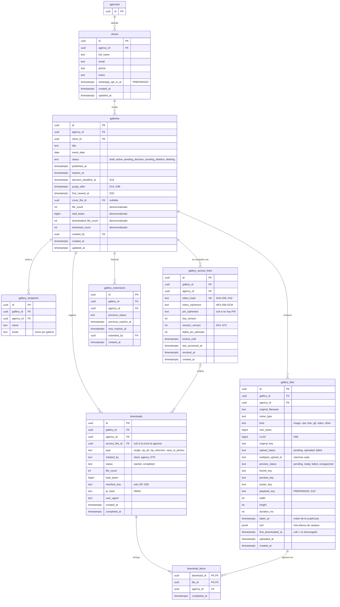
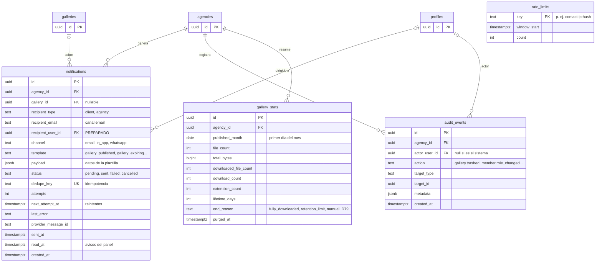
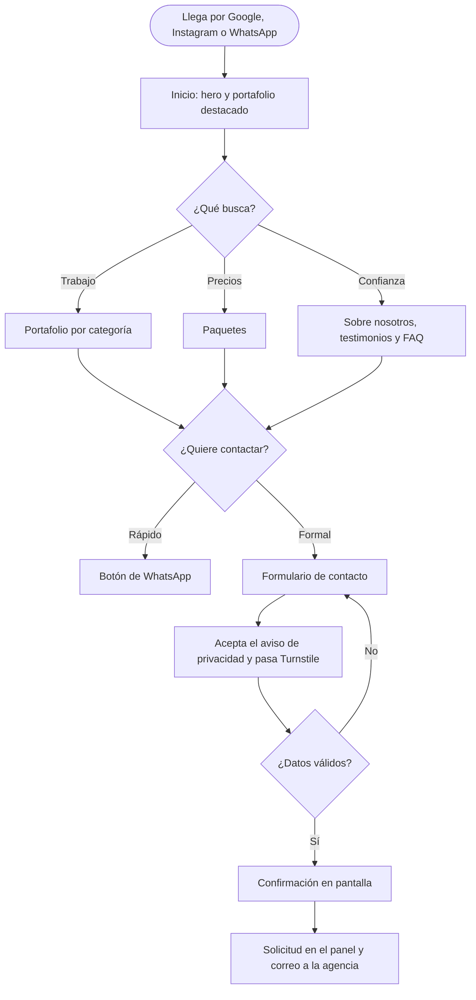
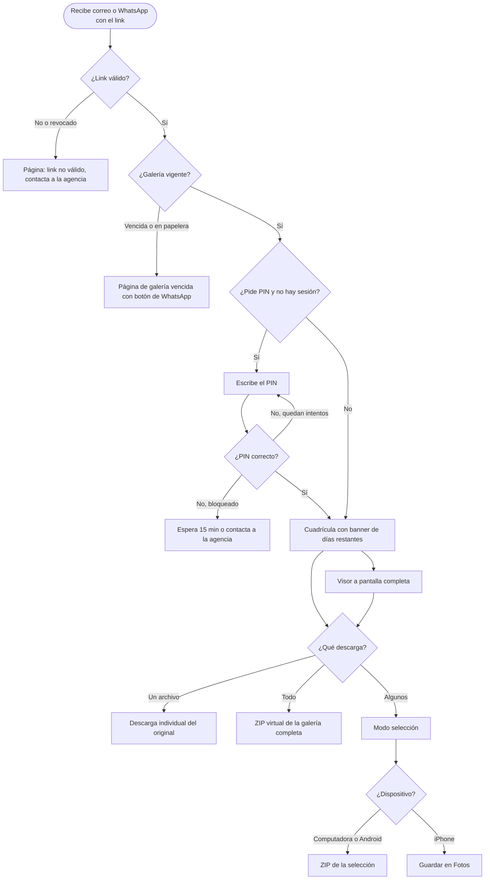
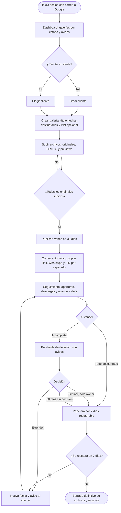
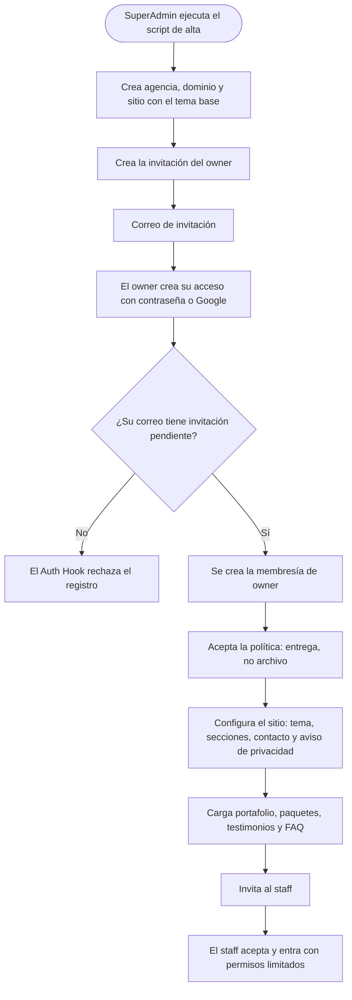

# Fase 1 · Parte B: Datos y usuarios

- **Versión:** v1.2 · 2026-10-11 (v1.2: D67–D78 aprobadas; migraciones por hito, D89. v1.1: integra las respuestas a P-B1–P-B3 → D79–D81 y agrega la tabla `gallery_stats`)
- **Estado:** ✅ aprobada por el equipo (2026-10-11)
- **Relacionado:** [project-log.md](project-log.md) (decisiones D#) · [phase-1a-architecture.md](phase-1a-architecture.md) (arquitectura)

## Índice

1. [Convenciones del modelo](#1-convenciones-del-modelo)
2. [Modelo de datos (ERD)](#2-modelo-de-datos-erd)
3. [Reglas, índices e integridad](#3-reglas-índices-e-integridad)
4. [Columnas vs. JSONB](#4-columnas-vs-jsonb)
5. [Aislamiento por agencia y RLS](#5-aislamiento-por-agencia-y-rls)
6. [Borrado y retención de datos](#6-borrado-y-retención-de-datos)
7. [Actores y matriz de permisos](#7-actores-y-matriz-de-permisos)
8. [Endpoints de Nest por módulo](#8-endpoints-de-nest-por-módulo)
9. [Flujos de usuario](#9-flujos-de-usuario)
10. [Tamaño estimado de la base de datos](#10-tamaño-estimado-de-la-base-de-datos)
11. [Decisiones propuestas y preguntas abiertas](#11-decisiones-propuestas-y-preguntas-abiertas)

---

## 1. Convenciones del modelo

| Tema | Convención | Por qué |
|---|---|---|
| Nombres | Tablas en inglés, `snake_case` y en plural. Claves foráneas como `<entidad>_id`. | Consistencia. Drizzle las expone en TypeScript como `camelCase`. |
| Identificadores | `uuid` **v7**, generado en Nest. | **No adivinable:** no revela cuántos registros hay ni permite recorrerlos probando números. **Se conoce antes del `INSERT`:** la clave en R2 usa el id del archivo. **v7 es ordenable por tiempo:** los índices crecen al final en vez de dispersarse, como pasa con v4. |
| Fechas | `timestamptz`, guardado en UTC. `date` para fechas sin hora (fecha del evento). | La zona horaria de la agencia se aplica al mostrar y al calcular el vencimiento (S2). |
| Dinero | Entero en **centavos** (`price_cents`). | Con decimales binarios, `0.1 + 0.2 ≠ 0.3`. |
| Enumeraciones | `text` + restricción `CHECK`. Los tipos de TypeScript salen de los esquemas Zod de `packages/shared`. | Agregar o quitar un valor es una migración simple. Los `enum` nativos de Postgres no permiten quitar valores. |
| Multi-tenancy | `agency_id not null` en **toda** tabla con datos de una agencia, incluidas las tablas hijas. | La capa 2 de RLS (D59) filtra sin joins y las consultas por agencia usan índices. |
| Integridad entre agencias | **Claves foráneas compuestas**: `(parent_id, agency_id) → parent(id, agency_id)`. | La propia BD garantiza que un hijo y su padre pertenecen a la **misma agencia**. Ni un bug puede colgar un archivo de la galería de otra agencia. |
| Auditoría básica | `created_at`, `updated_at` y `created_by` donde aporta. | — |
| Borrado | **Físico**, sin *soft delete*, excepto las galerías, que tienen su propio ciclo de vida. | El *soft delete* (marcar `deleted_at` en vez de borrar) obliga a filtrar esa columna en todas las consultas y retiene datos personales que la ley pide eliminar. |
| Dónde vive | Esquema de Drizzle en `apps/api/src/db/schema/`. Migraciones SQL en `apps/api/drizzle/`. Lo específico de Supabase (rol `app_api`, RLS, `pg_cron`, Auth Hook) va en **migraciones personalizadas** del mismo historial. | Un solo historial de cambios para toda la BD, versionado en el repo. |
| Cuándo se crea cada tabla | **Por hito** (D89). Este ERD es el diseño objetivo; cada tabla nace en la migración del hito que la usa. El reparto por hito está en la Parte C §2.1. Las columnas marcadas "PREPARADO" sí se crean desde el inicio. | Ninguna tabla sin código que la use y menos esquema que explicar. Cambiar una tabla que aún no existe no cuesta una migración. |

---

## 2. Modelo de datos (ERD)

El modelo se divide en tres dominios para que se pueda leer. Las tablas que se repiten entre diagramas (`agencies`, `galleries`, `profiles`) se muestran resumidas.

### 2.1 Plataforma, equipo y sitio público

```mermaid
erDiagram
    agencies ||--o{ agency_domains : "se resuelve por"
    agencies ||--|| agency_sites : "se configura con"
    agencies ||--o{ agency_members : "tiene"
    profiles ||--o{ agency_members : "pertenece a"
    agencies ||--o{ agency_invitations : "invita"
    agencies ||--o{ site_pages : "publica"
    agencies ||--o{ portfolio_categories : "organiza"
    portfolio_categories ||--o{ portfolio_items : "agrupa"
    agencies ||--o{ packages : "ofrece"
    agencies ||--o{ testimonials : "muestra"
    agencies ||--o{ faqs : "responde"
    agencies ||--o{ blog_posts : "escribe"
    agencies ||--o{ contact_requests : "recibe"
    packages |o--o{ contact_requests : "interés en"

    agencies {
        uuid id PK
        text slug UK
        text name
        text status "active, suspended"
        text timezone "America/Mexico_City"
        text locale "es-MX"
        text currency "MXN"
        text notification_email "Gmail de la agencia"
        int retention_days "60 por defecto, D16"
        jsonb notification_preferences "D33"
        timestamptz storage_policy_accepted_at "D15"
        timestamptz created_at
        timestamptz updated_at
    }
    agency_domains {
        uuid id PK
        uuid agency_id FK
        text hostname UK "en minúsculas"
        text kind "platform_subdomain, custom"
        bool is_primary "uno por agencia"
        timestamptz verified_at "PREPARADO"
    }
    profiles {
        uuid id PK "igual a auth.users.id"
        text full_name
        bool is_platform_admin "SuperAdmin"
        timestamptz created_at
    }
    agency_members {
        uuid agency_id PK, FK
        uuid user_id PK, FK
        text role "owner, staff"
        timestamptz created_at
    }
    agency_invitations {
        uuid id PK
        uuid agency_id FK
        text email
        text role "owner, staff"
        text token_hash UK
        uuid invited_by FK
        timestamptz expires_at
        timestamptz accepted_at
        timestamptz revoked_at
    }
    agency_sites {
        uuid agency_id PK, FK
        text template_key "MVP: base"
        jsonb theme "colores, fuentes, radios"
        jsonb sections "tipo, variante, orden, props"
        jsonb contact "whatsapp, correo, ciudad"
        jsonb social_links "red y url"
        jsonb seo "título, descripción, imagen"
        text logo_key
        text favicon_key
        timestamptz updated_at
    }
    site_pages {
        uuid id PK
        uuid agency_id FK
        text slug "único por agencia"
        text title
        text body_md "aviso de privacidad, D36"
        bool is_published
        timestamptz updated_at
    }
    portfolio_categories {
        uuid id PK
        uuid agency_id FK
        text slug "único por agencia"
        text name
        text description
        int sort_order
        bool is_published
    }
    portfolio_items {
        uuid id PK
        uuid agency_id FK
        uuid category_id FK
        text media_kind "image, embed"
        text image_base_key "800, 1600 y 2560 px, D51"
        int width
        int height
        text embed_provider "youtube, vimeo, D35"
        text embed_video_id
        text alt_text
        int sort_order
        bool is_featured "aparece en el inicio"
    }
    packages {
        uuid id PK
        uuid agency_id FK
        text name
        text description_md
        text price_type "fixed, from, quote, D22"
        int price_cents "null si quote"
        jsonb features "lista de incluidos"
        text notes
        int sort_order
        bool is_published
    }
    testimonials {
        uuid id PK
        uuid agency_id FK
        text author_name
        text event_label "p. ej. Boda 2025"
        text body
        int sort_order
        bool is_published
    }
    faqs {
        uuid id PK
        uuid agency_id FK
        text question
        text answer_md
        int sort_order
        bool is_published
    }
    blog_posts {
        uuid id PK
        uuid agency_id FK
        text slug "único por agencia"
        text title
        text excerpt
        text body_md
        text cover_key
        text status "draft, published"
        timestamptz published_at
        jsonb seo
    }
    contact_requests {
        uuid id PK
        uuid agency_id FK
        uuid package_id FK "nullable"
        text name
        text email
        text phone
        date event_date
        text message
        text status "new, contacted, archived"
        timestamptz privacy_accepted_at "obligatorio"
        text ip_hash "HMAC"
        timestamptz created_at
    }
```

### 2.2 Clientes, galerías y descargas

### 2.3 Avisos, métricas y operación

`audit_events` es **Should**: registra solo las acciones sensibles (papelera, eliminar ahora, extender, regenerar link, cambios de miembros). Sirve para dar soporte ("¿quién borró esta galería?") y es la base de la auditoría del SaaS.

`gallery_stats` (D79) es la huella **anónima** que deja una galería al purgarse. `finishPurge` la inserta **en la misma transacción** en que borra la galería. Mientras la tabla no exista (D89), `finishPurge` solo borra. No guarda título, cliente, destinatarios ni nombres de archivo, solo cifras. Sirve para dos cosas:
- que la agencia vea cuánto entrega al mes;
- calcular los costos reales del SaaS: GB por galería, porcentaje que se descarga completa, cuántas se extienden.

---

## 3. Reglas, índices e integridad

Solo se detallan las tablas con reglas no obvias. Las demás llevan su clave primaria, `agency_id` indexado y sus `UNIQUE` señalados en el ERD.

**`galleries`**

| Regla | Por qué |
|---|---|
| `CHECK`: `active` ⇒ `published_at` y `expires_at` no nulos; `pending_decision` ⇒ `decision_deadline_at` no nulo; `pending_deletion` ⇒ `purge_after` no nulo. | La BD rechaza estados incoherentes aunque haya un bug en el servicio. |
| `CHECK`: `0 ≤ downloaded_file_count ≤ file_count`. | Detecta errores en los contadores. |
| Índices `(status, expires_at)`, `(status, decision_deadline_at)` y `(status, purge_after)`. | El job `lifecycle` busca candidatos sin recorrer la tabla. |
| Índice `(agency_id, status, created_at desc)`. | Listado del panel por estado. |
| FK compuesta `(client_id, agency_id) → clients(id, agency_id)`. | Integridad entre agencias. |
| `cover_file_id → gallery_files(id)` con `ON DELETE SET NULL`. | Portada opcional; si se borra el archivo, no se rompe nada. |

Los contadores (`file_count`, `total_bytes`, `downloaded_file_count`, `download_count`) se actualizan **en la misma transacción** que el cambio que los afecta: archivo marcado `uploaded`, archivo borrado en borrador, `recordItems` (Parte A §3.8).

**`gallery_files`**

| Regla | Por qué |
|---|---|
| `CHECK`: `upload_status = 'uploaded'` ⇒ `crc32` y `size_bytes` no nulos. | Ningún archivo entra a un ZIP sin su CRC-32 (D66). |
| `CHECK`: `crc32` entre 0 y 4,294,967,295. | Es un entero de 32 bits sin signo, por eso se guarda en `bigint`. |
| Índice `(gallery_id, taken_at, original_filename, id)`. | Paginación **por cursor** de la cuadrícula: estable y rápida aunque haya 1,000 archivos. A diferencia de `OFFSET`, no se salta ni repite filas. |
| Índice parcial `(created_at) WHERE upload_status = 'pending'`. | Limpieza de subidas abandonadas (Parte A §3.5). |
| FK compuesta `(gallery_id, agency_id) → galleries(id, agency_id)`. | Integridad entre agencias. |
| `exif` con **lista blanca**: cámara, lente, distancia focal, apertura, velocidad, ISO y fecha. | ~300 bytes en vez de varios KB por archivo. Además, el GPS nunca llega a la BD. |

**`gallery_access_links`**

| Regla | Por qué |
|---|---|
| Índice único parcial `(gallery_id) WHERE revoked_at IS NULL`. | **Un solo link activo por galería** (D19). Regenerar = revocar el actual y crear otro. |
| `token_hash` `UNIQUE`. | Búsqueda del link en O(1) sin guardar el token en claro (D42). |
| `session_version`: se incrementa al cambiar el PIN o al pulsar "cerrar sesiones". | Las cookies llevan `link_id` + `session_version`; si no coinciden, la sesión deja de valer (D43, D72). |

**`downloads` y `download_items`**

| Regla | Por qué |
|---|---|
| `CHECK`: `type` en (`zip_all`, `zip_selection`) ⇒ `manifest_key` no nulo. | El Worker necesita el manifiesto (D65). |
| `initiated_by = 'agency'` ⇒ `recordItems` **no** toca `first_downloaded_at` ni los contadores. | La copia que descarga la agencia (D15) no cuenta como entrega al cliente; si contara, podría disparar un borrado automático indebido (D70). |
| PK compuesta `(download_id, file_id)` + `ON CONFLICT DO NOTHING`. | El Worker puede reportar el mismo archivo dos veces (reintentos, Range) sin efectos dobles: **reportes idempotentes** (D74). |
| Índice `(gallery_id, created_at desc)`. | Historial de descargas en el panel. |

**`notifications`**

| Regla | Por qué |
|---|---|
| `dedupe_key` `UNIQUE`. | Idempotencia: el mismo aviso no se crea dos veces (Parte A §3.11). |
| Índice parcial `(next_attempt_at) WHERE status IN ('pending', 'failed')`. | El dispatcher encuentra rápido lo que tiene que enviar o reintentar. |
| Índice parcial `(agency_id, created_at desc) WHERE channel = 'in_app' AND read_at IS NULL`. | Contador de "no leídos" del panel. |

**Otras**

| Tabla | Regla |
|---|---|
| `agency_domains` | `hostname` único; índice único parcial `(agency_id) WHERE is_primary`. |
| `agency_invitations` | Índice único parcial `(agency_id, lower(email)) WHERE accepted_at IS NULL AND revoked_at IS NULL`: una invitación pendiente por persona. |
| `gallery_recipients` | Único `(gallery_id, lower(email))`. |
| `packages` | `CHECK`: `price_type = 'quote'` ⇔ `price_cents IS NULL`; `price_cents ≥ 0`. |
| `portfolio_items` | `CHECK`: `image` ⇒ `image_base_key`, `width` y `height` no nulos; `embed` ⇒ `embed_provider` y `embed_video_id` no nulos. |
| `clients` | Índice `(agency_id, lower(email))` para encontrar clientes repetidos. No es único: una familia puede compartir correo, y el panel sugiere el existente. |
| `contact_requests` | Índice `(agency_id, status, created_at desc)`. |

---

## 4. Columnas vs. JSONB

**La regla:** lo que se **filtra, ordena, une o usa una regla de negocio** va en columna. Lo que se lee y escribe **como bloque**, cuya forma varía o evoluciona y que **solo la interfaz interpreta**, va en JSONB. Todo JSONB se valida con un esquema Zod de `packages/shared` al escribir (en Nest) y al leer (en Next).

| Campo JSONB | Contenido | Por qué JSONB | Esquema Zod |
|---|---|---|---|
| `agencies.notification_preferences` | Activado/desactivado por plantilla | Se lee completo; crece con cada aviso nuevo | `NotificationPreferencesSchema` |
| `agency_sites.theme` | Colores, fuentes, radios | Solo la UI lo interpreta; evoluciona con el diseño | `ThemeSchema` |
| `agency_sites.sections` | Lista ordenada de secciones con props por tipo | Cada tipo de sección tiene props distintas | `SectionsSchema`: unión discriminada por `type` |
| `agency_sites.contact` | WhatsApp, correo público, ciudad, horario | Bloque de presentación | `ContactSchema` |
| `agency_sites.social_links` | Lista de red + URL | Lista pequeña que se lee completa | `SocialLinksSchema` |
| `agency_sites.seo`, `blog_posts.seo` | Título, descripción, imagen para compartir | Bloque de presentación | `SeoSchema` |
| `packages.features` | Lista de incluidos | Solo se muestra | `z.array(z.string())` |
| `gallery_files.exif` | Datos de cámara (lista blanca) | Varía por cámara; solo se muestra | `ExifSchema` |
| `notifications.payload` | Datos para la plantilla | Cada plantilla necesita datos distintos | Un esquema por plantilla |
| `audit_events.metadata` | Detalle de la acción | Cada acción registra cosas distintas | Un esquema por acción |

**Campos que podrían parecer JSONB, pero van en columna:**

| Campo | Por qué es columna |
|---|---|
| `agencies.retention_days` | El job `lifecycle` lo usa para calcular `decision_deadline_at`. |
| `gallery_files.taken_at` | Se ordena por él. |
| `gallery_files.crc32`, `size_bytes` | El manifiesto del ZIP los necesita con garantías (`CHECK`). |
| Estados, contadores y claves de R2 | Se filtran, se validan y los usa la lógica de negocio. |

**Costo de JSONB:** Postgres no valida su forma ni sus referencias. Por ejemplo, una sección "portafolio" que apunta a una categoría borrada. Mitigación: Zod al guardar, y el render ignora referencias que ya no existen en lugar de fallar.

---

## 5. Aislamiento por agencia y RLS

Recordatorio de D59 y D60:
- **Capa 0 (MVP):** la API automática de Supabase queda cerrada.
- **Capa 1 (MVP):** aislamiento en el código de Nest.
- **Capa 2 (antes de la segunda agencia):** RLS por agencia.

**Capa 0, en la migración inicial:**
1. `ENABLE ROW LEVEL SECURITY` en **todas** las tablas del esquema `public`.
2. `REVOKE ALL` sobre esas tablas a `anon` y `authenticated`. Sin políticas para ellos: la API REST de Supabase no puede leer ni escribir nada.
3. Rol propio `app_api` (el que usa Nest) con la política `FOR ALL TO app_api USING (true) WITH CHECK (true)`.

**Capa 2, por tabla (diseño adelantado para no improvisarlo después):**

| Tablas | Política de `app_api` en la capa 2 | Nota |
|---|---|---|
| Todas las que tienen `agency_id` | `agency_id = current_setting('app.agency_id')::uuid` | Nest fija `app.agency_id` en cada transacción con `set_config`. |
| `agency_domains` | Lectura por `hostname` **sin** contexto de agencia, mediante la función `resolve_agency(host)` (`SECURITY DEFINER`) | La resolución ocurre *antes* de conocer la agencia. |
| `profiles` | El propio usuario + los miembros de sus agencias | Los perfiles no pertenecen a una sola agencia. |
| `rate_limits` | Sin filtro | Datos de plataforma, no de una agencia. |
| Jobs de cron | Un rol `app_jobs` que puede **listar candidatos** de todas las agencias; cada galería se procesa después con su propio `app.agency_id` | El cron trabaja sobre varias agencias. |

**Por qué diseñar ya la capa 2:** las FK compuestas, el `agency_id` en todas las tablas hijas y la función de resolución por host se crean **desde el MVP**. Así, activar la capa 2 se reduce a cambiar políticas y añadir el interceptor que fija el contexto, sin migraciones de datos.

---

## 6. Borrado y retención de datos

### 6.1 Qué pasa al borrar un registro padre

| Relación | Al borrar el padre | Por qué |
|---|---|---|
| `galleries` → archivos, destinatarios, links, extensiones, descargas, `download_items` | `CASCADE` | La purga borra todo de una vez, **después** de vaciar R2 (Parte A §3.10). |
| `galleries` → `notifications` | `SET NULL` | El aviso a la agencia ("se eliminó la galería X") sigue visible y se depura por su propia retención. |
| `clients` → `galleries` | `RESTRICT` | No se puede borrar un cliente que aún tiene galerías. |
| `packages` → `contact_requests` | `SET NULL` | La solicitud sobrevive aunque el paquete ya no exista. |
| `portfolio_categories` → `portfolio_items` | `RESTRICT` | El panel pide mover o borrar los elementos antes; evita borrados masivos accidentales. |
| `auth.users` → `profiles` → `agency_members` | `CASCADE` | Si se borra la cuenta, desaparece su membresía. |
| `profiles` → `created_by`, `invited_by`, `extended_by`, `actor_user_id` | `SET NULL` | El historial se conserva aunque la persona ya no esté. |

### 6.2 Retención (cuánto tiempo se guarda cada dato)

La aplica el job `lifecycle` una vez al día.

| Dato | Regla | Base |
|---|---|---|
| Galería, sus archivos y su historial de descargas | Ciclo de vida: hasta ~97 días sin extensión | D14, D16, D48 |
| Manifiestos de ZIP en R2 | Se borran cuando la galería deja de estar `active` y, en todo caso, con la purga | D65 |
| Archivos `pending` abandonados | 7 días | Parte A §3.5 |
| Solicitudes de contacto | **12 meses** desde su creación; después se borran solas | D80 · LFPDPPP: conservar solo lo necesario |
| Clientes sin galerías | **Aviso en el panel a los 12 meses** sin galerías, con botones "Anonimizar" y "Borrar". Nada se borra solo. | D81 |
| Galerías purgadas | Queda una fila **anónima** en `gallery_stats` | D79 |
| Avisos (`notifications`) | 90 días después de enviados o leídos | Contienen nombres y correos en `payload` |
| Invitaciones aceptadas, vencidas o revocadas | 30 días | — |
| `rate_limits` | Ventanas vencidas, diario | — |
| `audit_events` (Should) | 12 meses | Soporte y seguridad |

---

## 7. Actores y matriz de permisos

### 7.1 Actores

| Actor | Quién es | Cómo se identifica |
|---|---|---|
| **Visitante** | Cualquiera que entra al sitio público de la agencia | Nadie lo identifica |
| **Cliente final** | Quien tiene el link de una galería (y el PIN, si lo hay) | Token + cookie de sesión de la galería (D42, D43). Sin cuenta. |
| **Staff** | Miembro de la agencia con rol `staff` | Supabase Auth + membresía (D26, D34) |
| **Owner** | Miembro de la agencia con rol `owner` | Supabase Auth + membresía |
| **SuperAdmin** | Ustedes dos, como operadores de la plataforma | `profiles.is_platform_admin`. Sin interfaz en el MVP: actúa con scripts y el dashboard de Supabase (D27). |

### 7.2 Matriz de permisos

✅ permitido · — no permitido · 🔧 solo con scripts o el dashboard

| Capacidad | Visitante | Cliente | Staff | Owner | SuperAdmin |
|---|:-:|:-:|:-:|:-:|:-:|
| Ver sitio público, portafolio, paquetes y blog | ✅ | ✅ | ✅ | ✅ | ✅ |
| Enviar solicitud de contacto | ✅ | ✅ | — | — | — |
| Ver una galería (cuadrícula y visor) | — | ✅ su galería | ✅ en el panel | ✅ en el panel | — |
| Descargar: individual, ZIP, selección, Guardar en Fotos | — | ✅ | ✅ (no cuenta para el avance, D70) | ✅ (ídem) | — |
| Dashboard y avisos del panel | — | — | ✅ | ✅ | — |
| Clientes: crear y editar | — | — | ✅ | ✅ | — |
| Clientes: borrar (datos personales) | — | — | — | ✅ | — |
| Galerías: crear, subir, publicar, regenerar previews | — | — | ✅ | ✅ | — |
| Link y PIN: copiar, enviar, regenerar, cerrar sesiones | — | — | ✅ | ✅ | — |
| Galerías: extender o restaurar | — | — | ✅ | ✅ | — |
| Galerías: mandar a la papelera y "Eliminar ahora" | — | — | — | ✅ | — |
| Solicitudes de contacto: ver y cambiar estado | — | — | ✅ | ✅ | — |
| Portafolio | — | — | ✅ | ✅ | — |
| Testimonios, FAQ y blog | — | — | ✅ | ✅ | — |
| Paquetes y precios | — | — | — | ✅ | — |
| Configuración del sitio: tema, secciones, contacto, SEO, aviso de privacidad | — | — | — | ✅ | — |
| Miembros e invitaciones | — | — | — | ✅ | — |
| Preferencias de avisos y política de almacenamiento | — | — | — | ✅ | — |
| Dominios de la agencia | — | — | — | Lectura | 🔧 |
| Crear o suspender agencias | — | — | — | — | 🔧 |

**Una aclaración sobre el SuperAdmin:** no tiene acceso a galerías privadas **desde la app** (mínimo privilegio, D27). Técnicamente puede ver la BD desde el dashboard de Supabase, y por eso el aviso de privacidad menciona a la plataforma como encargada.

---

## 8. Endpoints de Nest por módulo

Es la superficie de la API del MVP, organizada por módulo (Parte A §2.4). Servirá como base de los tickets en la Fase 2. **Protección:** `Público` = sin autenticación · `Sesión` = cookie de galería · `Staff+` = staff u owner · `Owner` = solo owner · `HMAC` = firma del Worker · `Secreto` = cron.

| Módulo | Endpoints principales | Protección |
|---|---|---|
| `auth` | `GET /admin/me` (perfil, agencia, rol) | JWT |
| `tenancy` | `GET /public/tenant` (agencia por `X-Tenant-Host`) | Público |
| `site` | `GET /public/site` · `GET /public/pages/:slug` · `GET/PUT /admin/site` (tema, secciones, contacto, SEO) · `PUT /admin/pages/:slug` | Público / Owner |
| `portfolio` | `GET /public/portfolio` · CRUD `/admin/portfolio/categories` · CRUD `/admin/portfolio/items` · `POST /admin/portfolio/uploads` (firma) | Público / Staff+ |
| `packages` | `GET /public/packages` · CRUD `/admin/packages` | Público / Owner |
| `content` | `GET /public/testimonials`, `/public/faqs`, `/public/blog` · CRUD `/admin/testimonials`, `/admin/faqs`, `/admin/blog-posts` | Público / Staff+ |
| `contact` | `POST /public/contact-requests` (Turnstile + límite por IP) · `GET/PATCH /admin/contact-requests` | Público / Staff+ |
| `clients` | `GET/POST/PATCH /admin/clients` · `DELETE /admin/clients/:id` | Staff+ / Owner |
| `galleries` | CRUD `/admin/galleries` · `POST /:id/publish` · `POST /:id/extend` · `POST /:id/restore` · `POST /:id/link/regenerate` · `POST /:id/pin` · `POST /:id/sessions/revoke` · `GET /:id/stats` | Staff+ |
| `galleries` (destructivas) | `POST /:id/trash` · `POST /:id/purge-now` | Owner |
| `uploads` | `POST /admin/galleries/:id/files` · multipart: `create`, `sign-part`, `list-parts`, `complete`, `abort` · `POST /admin/files/:id/complete` (con CRC-32) · `POST /admin/files/:id/previews` | Staff+ |
| `gallery-access` | `GET /public/galleries/:token` · `POST /public/galleries/:token/pin` · `GET /public/galleries/:token/files?cursor=` · `GET /public/galleries/:token/files/:id/download` | Token / Sesión |
| `downloads` | `POST /public/galleries/:token/downloads` (ZIP: crea el manifiesto y firma el link) · `POST /public/galleries/:token/downloads/:id/saved` (Guardar en Fotos) · `POST /admin/galleries/:id/downloads` (copia de la agencia) · `POST /internal/downloads/:id/progress` | Sesión / Staff+ / HMAC |
| `agencies` | `GET/PATCH /admin/agency` (preferencias, política) · `GET/PATCH/DELETE /admin/members` · `POST/DELETE /admin/invitations` · `GET /admin/domains` | Owner (lectura de la agencia: Staff+) |
| `notifications` | `GET /admin/notifications` · `PATCH /admin/notifications/:id/read` | Staff+ |
| `cron` | `POST /cron/lifecycle` · `POST /cron/reminders` · `POST /cron/notifications` | Secreto |

Del lado de Next, las rutas `/g/[token]/api/*` y `/api/*` se reenvían a estas rutas de Nest (D62).

---

## 9. Flujos de usuario

### 9.1 Visitante: del sitio al contacto

### 9.2 Cliente final: de abrir el link a descargar

### 9.3 Dueño y staff: ciclo de una galería

### 9.4 Alta de la agencia y de su equipo

---

## 10. Tamaño estimado de la base de datos

Supuestos: 15 galerías/mes × 650 archivos, residencia promedio de 1.5 meses, EXIF con lista blanca.

| Tabla | Filas vivas | Tamaño aprox. (con índices) |
|---|---|---|
| `gallery_files` | ~15,000 | ~15 MB |
| `download_items` | ~45,000 | ~5 MB |
| `notifications` (90 días) | ~2,000 | ~2 MB |
| Resto (sitio, clientes, solicitudes, descargas…) | Pocos miles | ~5 MB |
| **Total, 1 agencia** | | **≈ 30 MB de los 500 MB del plan gratuito** |

**Dato para la Parte C:** a 10 agencias son ~300 MB, todavía dentro del plan gratuito pero cerca del límite. A partir de ahí, Supabase Pro (8 GB incluidos) deja de ser opcional. Mantener la lista blanca de EXIF y la retención de avisos es lo que más ayuda a no llegar antes.

---

## 11. Decisiones propuestas y preguntas abiertas

### 11.1 Decisiones de esta parte (✅ aprobadas el 2026-10-11)

| # | Decisión | Sección |
|---|---|---|
| D67 | IDs `uuid` v7 generados en Nest | §1 |
| D68 | Enumeraciones como `text` + `CHECK`; tipos desde Zod | §1 |
| D69 | Claves foráneas compuestas `(id, agency_id)` para garantizar la consistencia entre agencias | §1, §3 |
| D70 | Las descargas que inicia la agencia no cuentan para el avance del cliente | §3 |
| D71 | Borrar clientes es solo del owner; `RESTRICT` si tiene galerías | §6.1, §7.2 |
| D72 | Un solo link activo por galería (índice único parcial) + `session_version` para cerrar sesiones | §3 |
| D73 | Avisos del panel compartidos por toda la agencia: un solo `read_at` en el MVP; `recipient_user_id` queda preparado para avisos personales | §2.3 |
| D74 | `download_items` con PK compuesta: reportes del Worker idempotentes | §3 |
| D75 | Sin *soft delete*: borrado físico, salvo el ciclo de vida de las galerías | §1 |
| D76 | Retención fija: avisos 90 días, invitaciones 30 días, auditoría 12 meses | §6.2 |
| D77 | EXIF con lista blanca de campos (sin GPS) | §3 |
| D78 | `audit_events` como Should, solo para acciones sensibles | §2.3 |
| D79 ✅ | Fila anónima en `gallery_stats` al purgar cada galería | §2.3, §6.2 |
| D80 ✅ | Solicitudes de contacto: se borran a los 12 meses | §6.2 |
| D81 ✅ | Clientes sin galerías: aviso en el panel a los 12 meses, sin borrado automático | §6.2 |
| D89 ✅ | Migraciones solo del hito en curso (revisión de alcance del 2026-10-11) | §1 |

### 11.2 Preguntas resueltas (✅ 2026-10-09)

| # | Pregunta | Respuesta | Decisión |
|---|---|---|---|
| P-B1 | Al purgar una galería, ¿se conserva una fila anónima de estadísticas? | Sí | D79: tabla `gallery_stats` |
| P-B2 | ¿Cuánto tiempo se guardan las solicitudes de contacto? | 12 meses | D80 |
| P-B3 | ¿Qué pasa con los clientes que llevan mucho tiempo sin galerías? | Aviso en el panel a los 12 meses; la agencia decide | D81 |
