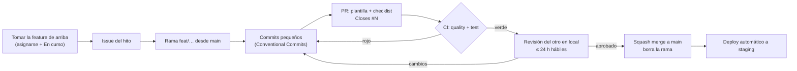
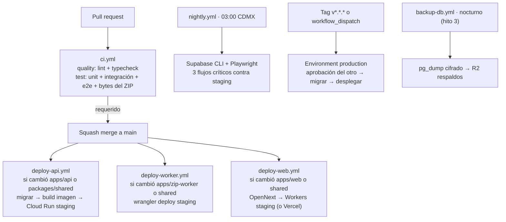

# Fase 2 · Metodología y división del trabajo

- **Versión:** v1.3 · 2026-10-13 (v1.3: llaves nuevas de Supabase, Data API apagada y URL de migraciones por el *session pooler*, D121; v1.2: nombre **Focal Drop** / `focaldrop` en lugar de `darkroom`, D118; v1.1: D103–D110 aprobadas)
- **Estado:** ✅ aprobada por el equipo (2026-10-11, "Fase 2 aprobada")
- **Relacionado:** [project-log.md](project-log.md) (decisiones D#) · [phase-1c-scope-and-closing.md](phase-1c-scope-and-closing.md) (hitos y MoSCoW) · [phase-1a-architecture.md](phase-1a-architecture.md) · [phase-1b-data-and-users.md](phase-1b-data-and-users.md)

> La Fase 1 definió **qué** se construye. Esta fase define **cómo se trabaja**: repo, flujo de Git, entornos, CI, calidad, reparto y el backlog del hito 0. Sigue siendo un documento de diseño: no hay código ni comandos ejecutados; los comandos que aparecen son el **contrato** de lo que el repo ofrecerá.
>
> Decisiones ya tomadas con el selector (2026-10-11): nombre en clave `darkroom` (D98, reemplazado por **Focal Drop**, D118), reparto por capa con rotación (D99), ramas cortas + PR revisado (D100), Supabase CLI local + bucket R2 de desarrollo (D101), README bilingüe (D102).

## Índice

1. [Nombre y repositorio](#1-nombre-y-repositorio)
2. [Estructura del monorepo](#2-estructura-del-monorepo)
3. [Flujo de Git y revisión](#3-flujo-de-git-y-revisión)
4. [Entornos y secretos](#4-entornos-y-secretos)
5. [Entorno local](#5-entorno-local)
6. [Integración y despliegue continuos](#6-integración-y-despliegue-continuos)
7. [Calidad: tests, lint y definición de "terminado"](#7-calidad-tests-lint-y-definición-de-terminado)
8. [División del trabajo y ritmo](#8-división-del-trabajo-y-ritmo)
9. [Backlog del hito 0](#9-backlog-del-hito-0)
10. [Documentación del repo](#10-documentación-del-repo)
11. [Decisiones de esta fase y supuestos](#11-decisiones-de-esta-fase-y-supuestos)

---

## 1. Nombre y repositorio

**Nombre: Focal Drop** (D118), identificador técnico **`focaldrop`**. Antes del 2026-10-13 se usó el nombre en clave `darkroom` (D98). Se usa en el repo, el monorepo (`@focaldrop/*`), los proyectos de Supabase y Google Cloud, los buckets y los Workers. Es el nombre de la **plataforma**; cada agencia conserva el suyo en la BD (P4).

**Repositorio:** `github.com/Rurbis/focaldrop`, público, sin licencia de código abierto ("All rights reserved", D6). El compañero entra como colaborador con permiso de escritura.

**Configuración del repo** (se hace en la issue #1 del hito 0):

| Ajuste | Valor | Por qué |
|---|---|---|
| Protección de `main` | PR obligatorio · 1 aprobación · checks `quality` y `test` requeridos · conversaciones resueltas · sin *force push* · **aplica también a administradores** | Nadie se salta la revisión, ni el dueño. Es lo que un reclutador espera ver. En repos públicos es gratis. |
| Escaneo de secretos + *push protection* | Activado | D6. Bloquea el push si detecta una llave. |
| Dependabot | Alertas de seguridad activadas · actualizaciones de versión **semanales y agrupadas** por ecosistema (máximo 5 PRs abiertos) | Sin agrupar, inunda el repo. Sin *auto-merge*: leer el changelog es parte del aprendizaje. |
| Plantillas de issue | `feature`, `bug`, `spike`, `design-feedback` (D24) | Cada tipo pide lo que importa (criterio de aceptación, pasos, pregunta del spike, captura). |
| Plantilla de PR | Checklist de "terminado" (§7.3) | La revisión empieza por el autor. |
| Labels | `hito:0` … `hito:4+` · `area:web` `area:api` `area:zip-worker` `area:shared` `area:infra` `area:docs` · `type:feature` `type:bug` `type:spike` `type:chore` `type:design-feedback` · `priority:must` `priority:should` `priority:could` | Filtrar el tablero por hito, persona y área. |
| GitHub Projects | Un tablero "Focal Drop MVP" con columnas Backlog → Hito actual → En curso → En revisión → Hecho, y vistas por hito y por persona | Gratis, vive junto a las issues, sin otra herramienta que mantener. |
| CODEOWNERS | **No** en el MVP | Con una persona por área, obligaría a que el autor se apruebe a sí mismo y bloquearía el PR. Basta con "1 aprobación". |
| Wiki y Discussions | Desactivados | La documentación vive en `docs/` y se versiona con el código. |

---

## 2. Estructura del monorepo

**Herramientas (D103):** `pnpm` *workspaces* + **Turborepo**. pnpm por instalaciones rápidas y dependencias estrictas (un paquete no puede usar lo que no declara). Turborepo porque ejecuta `lint`, `test` y `build` en paralelo, con caché, y permite correr solo lo afectado por un cambio (`--filter`). La configuración cabe en un archivo.

```text
focaldrop/
├── apps/
│   ├── web/            @focaldrop/web · Next.js 16 (App Router, TS, Tailwind v4)
│   ├── api/            @focaldrop/api · NestJS 12 (D115) (TS, Drizzle); Dockerfile aquí
│   │   └── drizzle/    migraciones SQL versionadas (Parte B §1)
│   └── zip-worker/     @focaldrop/zip-worker · Cloudflare Worker (TS, wrangler)
├── packages/
│   └── shared/         @focaldrop/shared · esquemas Zod, tipos, constantes, plantillas de correo
├── docs/
│   ├── project-log.md, phase-1a…, phase-1b…, phase-1c…, phase-2…   (migrados de files/)
│   ├── adr/            0001-….md … (Parte C §7)
│   └── runbook.md      (hito 3)
├── infra/
│   ├── supabase/       config.toml de la CLI y seed; sin migraciones (viven en apps/api/drizzle)
│   ├── cloudflare/     CORS de R2 y regla de ciclo de vida, como JSON versionado
│   └── gcp/            definición del servicio de Cloud Run y notas de WIF
├── .github/
│   ├── workflows/      ci.yml · deploy-api.yml · deploy-worker.yml · deploy-web.yml · nightly.yml · backup-db.yml
│   ├── ISSUE_TEMPLATE/ y PULL_REQUEST_TEMPLATE.md
│   └── dependabot.yml
├── CLAUDE.md · README.md · README.es.md
├── package.json · pnpm-workspace.yaml · turbo.json · .nvmrc · .editorconfig
└── eslint.config.js · prettier.config.js · tsconfig.base.json
```

**Reglas de dependencia**

- Las apps dependen de `packages/*`; los paquetes **nunca** dependen de apps.
- `@focaldrop/shared` no usa APIs exclusivas de Node: corre en el navegador, en Nest y en el Worker.
- Versiones fijadas: Node LTS vigente en `.nvmrc` y en `engines`; pnpm fijado con `packageManager` en `package.json`; TypeScript en modo `strict` con `noUncheckedIndexedAccess` en todos los paquetes.
- Cada app tiene su `.env.example` (§4.3) y su `README` corto que apunta al principal.

**Scripts raíz (contrato del repo):**

| Script | Qué hace |
|---|---|
| `pnpm dev` | Levanta web, api y zip-worker a la vez (Turbo) |
| `pnpm db:start` / `pnpm db:stop` | Supabase local en Docker |
| `pnpm db:migrate` | Aplica las migraciones de Drizzle a la BD local |
| `pnpm db:seed` | Agencia `demo`, owner local y datos de muestra |
| `pnpm db:reset` | Borra, migra y siembra de nuevo |
| `pnpm lint` · `pnpm typecheck` · `pnpm test` · `pnpm build` | Lo mismo que corre CI |
| `pnpm cron:run <job>` | Ejecuta un job de cron contra la API local (§5) |

---

## 3. Flujo de Git y revisión

**Modelo (D100): trunk-based.** `main` siempre está verde y desplegable a staging. Todo cambio entra por una rama corta y un PR revisado por la otra persona.



| Tema | Regla | Por qué |
|---|---|---|
| Nombres de rama | `feat/gallery-state-machine`, `fix/zip-utf8-names`, `chore/ci-cache`, `spike/opennext-workers`, `docs/adr-0006` | Se entiende el propósito sin abrir la rama. En inglés. |
| Commits | **Conventional Commits** con *scope* = app o paquete: `feat(api): add gallery state machine`, `fix(web): keep session on /admin reload`. En inglés, en imperativo. | El historial se lee como changelog. Con *squash merge*, el título del PR se vuelve el commit: también sigue el formato. |
| Tomar trabajo (D138) | Cada issue es una **feature vertical** (BD, API, web, pruebas y documentación) de una sola persona. Al terminar algo, se toma la de más arriba de "Hito actual" que nadie tenga: primero asignarse y moverla a "En curso", después empezar. **Una feature en curso por persona**; una segunda solo si la primera está bloqueada. Al tomar una pieza compartida (esquema de BD, `@focaldrop/shared`, layouts del panel), se avisa al otro. | Ninguno espera a que el otro termine su capa, y los dos conocen el sistema completo. |
| Tamaño del PR | Una feature por PR, de **máximo unos 2 días**. Si crece, se parte en rebanadas que funcionan de punta a punta. Meta: < 400 líneas netas. | Un PR grande no se revisa, se aprueba; y la revisión es en local. |
| Revisión | La otra persona revisa **siempre en local**, en ≤ 24 h hábiles. Revisar va antes de empezar una feature nueva. Comentarios con prefijo: `nit:` (opcional), `q:` (pregunta), sin prefijo (hay que atenderlo). | La revisión es la principal transferencia de conocimiento entre los dos, y nadie se queda bloqueado esperándola. |
| Bitácora (D138) | El PR no edita `docs/project-log.md`: deja una nota en `docs/log/` ([cómo](log/README.md)). Rubén integra las notas cada semana. | Dos PRs nunca chocan en la bitácora, así que mezclar uno no obliga a re-aprobar los demás. |
| Qué revisa el revisor | El checklist de §7.3, con énfasis en: `agency_id` en toda consulta nueva, Zod en todo payload nuevo, tests de lo crítico, nada de la agencia en el código. | Son los errores que más cuestan después. |
| Mezcla | El autor mezcla tras la aprobación y CI en verde. *Squash merge*. La rama se borra. | `main` lineal y limpio. |
| Spikes | Rama `spike/…` que **nunca se mezcla**. El resultado va en un comentario de la issue (números, capturas, veredicto) y, si cambia una decisión, en un ADR. | El código de un spike es desechable por definición; su conocimiento no. |
| Urgencias | Mismo flujo con etiqueta `priority:urgent`; la revisión es inmediata. | Sin atajos que después se vuelvan costumbre. |
| Versiones | Tag `v0.<hito>.0` al cerrar cada hito con una *GitHub Release* y notas; `v1.0.0` en el hito 3. | Marca los entregables en el historial, útil para el CV. |

**Migraciones de BD y ramas.** Cada migración es un archivo numerado en `apps/api/drizzle/`. Si dos PRs crean migraciones a la vez, quien mezcla segundo actualiza su rama con `main` y regenera su migración encima (Drizzle detecta el choque). Las migraciones son **aditivas y compatibles hacia atrás** (*expand/contract*): primero se agrega la columna nueva, se despliega el código que la usa, y solo después se quita la vieja en otra migración. Así el despliegue nunca depende de que el código y la BD cambien en el mismo instante.

---

## 4. Entornos y secretos

### 4.1 Entornos (D104)

| | Local | Staging | Producción |
|---|---|---|---|
| **Para qué** | Desarrollo diario | Demos a la agencia, pruebas de punta a punta, validar despliegues | La agencia y sus clientes |
| **Front** | `localhost:3000` | `focaldrop-staging.<cuenta>.workers.dev` (o `*.vercel.app` si S-4 falla) | Dominio de la agencia |
| **API** | `localhost:3001` | Cloud Run `focaldrop-api-staging` (`us-east4`) | Cloud Run `focaldrop-api` |
| **Worker de ZIP** | `wrangler dev` en `localhost:8787` | `focaldrop-zip-staging.<cuenta>.workers.dev` | `zip.<dominio>` |
| **BD y Auth** | Supabase CLI en Docker | Proyecto Supabase `focaldrop-staging` (Free, `us-east-1`) | Proyecto `focaldrop-prod` (Free hasta que un límite lo exija) |
| **Archivos** | Buckets `focaldrop-dev-*` en R2 (compartidos) | Buckets `focaldrop-staging-*` | Buckets `focaldrop-prod-*` |
| **Correo** | Visor local de la CLI (Mailpit) | Resend sin dominio: solo entrega al correo de la cuenta de la plataforma | Resend con el dominio de la agencia |
| **Cuándo se crea** | Hito 0, semana 1 | Hito 0 (S-0) | Hito 3 |

Supabase Free permite dos proyectos activos: exactamente staging y producción. El desarrollo diario no gasta ninguno porque es local. Staging se pausa si pasa una semana sin actividad; se reactiva desde el dashboard en un minuto.

### 4.2 Dónde vive cada secreto (D105)

| Lugar | Qué guarda | Cómo llega |
|---|---|---|
| **Bitwarden** (organización gratuita de 2 usuarios, D88) | La copia maestra de **todo**: contraseñas de cuentas, llaves de API, secretos de la app, con fecha y quién lo creó | A mano, al crearlo |
| `.env.local` de cada app (ignorado por Git) | Secretos de desarrollo | Cada quien lo llena a partir de `.env.example` |
| **GitHub Environments** `staging` y `production` | Secretos que usa CI para desplegar y migrar | `production` exige la **aprobación de la otra persona** antes de cada despliegue |
| Cloud Run | Variables de entorno del servicio | Las fija el workflow de deploy desde el Environment. Si crecen, se migra a Secret Manager (nivel gratuito). |
| Cloudflare Worker | Secretos del Worker (`HMAC`, URL de la API) | `wrangler secret` desde el workflow de deploy |
| Supabase Vault | `CRON_SECRET` (D46) | Migración que lee el valor de Vault; el valor se carga una vez por entorno |
| Google Cloud | **Sin llaves JSON**: CI se autentica con *Workload Identity Federation* | Configuración única en la issue #7 |

Reglas: ningún secreto en el repo, en issues, en chats ni en capturas. `.env.example` lleva **todas** las variables con un comentario de qué son y un valor de ejemplo inofensivo. Rotación: la llave de cifrado de tokens tiene `key_version` (D42); las demás se rotan desde Bitwarden y se documenta en el runbook (hito 3).

### 4.3 Inventario de variables

| Variable | Dónde | Pública | Nota |
|---|---|---|---|
| `NEXT_PUBLIC_SUPABASE_URL`, `NEXT_PUBLIC_SUPABASE_PUBLISHABLE_KEY` | web | Sí | Llave publicable (`sb_publishable_…`), que reemplaza a la *anon*. No abre nada: la Data API está apagada y RLS no tiene políticas para `anon` ni `authenticated` (D60, D121) |
| `API_URL` | web | — | URL de Nest para el reenvío y las llamadas de servidor |
| `DEFAULT_AGENCY_SLUG` | web, api | — | Solo fuera de producción (D7) |
| `SUPABASE_JWKS_URL`, `SUPABASE_JWT_AUDIENCE` | api | — | Validación del JWT (D57) |
| `DATABASE_URL` | api | — | Pooler en modo transacción, puerto 6543 (D63); en local, Postgres de la CLI |
| `MIGRATIONS_DATABASE_URL` | CI (migraciones) | — | *Session pooler*, puerto 5432: las migraciones necesitan una sesión completa, y la conexión directa es solo IPv6 en el plan Free (los runners de GitHub no tienen IPv6) (D121) |
| `SUPABASE_SECRET_KEY` | scripts de seed y de alta del owner | — | Llave secreta (`sb_secret_…`), que reemplaza a la *service_role*: API de administración de Auth. Nunca en web ni en el Worker (D121) |
| `R2_ACCOUNT_ID`, `R2_ACCESS_KEY_ID`, `R2_SECRET_ACCESS_KEY`, `R2_BUCKET_PRIVATE`, `R2_BUCKET_PUBLIC`, `R2_PUBLIC_BASE_URL` | api | — | **Solo Nest** tiene credenciales de R2 (Parte A §2.4) |
| `RESEND_API_KEY`, `EMAIL_FROM`, `EMAIL_PROVIDER` | api | — | `EMAIL_PROVIDER=mailpit` en local, `resend` en staging y producción |
| `TURNSTILE_SECRET_KEY` / `NEXT_PUBLIC_TURNSTILE_SITE_KEY` | api / web | — / Sí | Llaves de prueba de Cloudflare en local |
| `TOKEN_ENCRYPTION_KEY_V1` | api | — | AES-256-GCM para tokens y PIN (D42) |
| `GALLERY_SESSION_SECRET` | api | — | Firma de la cookie de galería (D43) |
| `ZIP_LINK_HMAC_SECRET` | api, zip-worker | — | Firma de los links del ZIP (D65) |
| `WORKER_PROGRESS_HMAC_SECRET`, `API_URL` | api, zip-worker | — | Reporte de avance del Worker a Nest |
| `CRON_SECRET` | api, Supabase Vault | — | D46 |
| `SENTRY_DSN` (por app), `SENTRY_ENVIRONMENT` | web, api, zip-worker | Semipública | D86 |

---

## 5. Entorno local

**Objetivo (D101, D90):** una persona nueva levanta todo en menos de 30 minutos con el README, sin tarjeta y sin internet salvo para los archivos.

| Pieza | Herramienta | Nota |
|---|---|---|
| Node y pnpm | Node LTS fijado en `.nvmrc`; pnpm por `corepack` | Misma versión que CI y que la imagen de Cloud Run |
| Postgres, Auth, `pg_cron`, `pg_net`, visor de correos | **Supabase CLI** (`supabase start`, Docker) | Gratis, sin cuenta. Studio local para ver tablas. Mailpit muestra los correos que manda Nest. |
| API y front | `pnpm dev` | Recarga en caliente en ambos |
| Worker de ZIP | `wrangler dev` con el *binding* de R2 apuntando al **bucket de desarrollo real** (*remote bindings*); si no está disponible, `wrangler dev --remote` | Así el Worker lee lo que Nest subió desde local |
| Archivos | Buckets `focaldrop-dev-*` en R2, compartidos por los dos | Es lo único que requiere internet y la cuenta de Cloudflare (tarjeta, $0). Se activa al empezar la subida, hito 1. Antes de eso, nada en local necesita R2. |
| Cron | `pnpm cron:run lifecycle` llama al endpoint local con el secreto | `pg_cron` real se prueba en staging; en local es más simple y determinista invocarlo a mano |
| Turnstile | Llaves de prueba de Cloudflare que siempre pasan | Sin cuenta |
| Auth | Confirmación de correo desactivada en local; Google solo en staging y producción | Google es Should de todos modos |
| Sistema operativo | Windows: **WSL2 (Ubuntu) con Docker Desktop en modo WSL**, recomendado. macOS y Linux: nativo. | Paridad con CI y con la imagen de Cloud Run; evita problemas de rutas y mayúsculas. Es una recomendación: todo funciona también en Windows nativo. |

**Datos de muestra (`pnpm db:seed`).** Crea la agencia `demo` con tema base, un owner local (correo y contraseña en el seed, válidos solo en Docker), un cliente, una galería en borrador con 5 archivos sintéticos pequeños (generados por el seed, **nunca fotos reales de la agencia**) y un dominio `localhost`. `DEFAULT_AGENCY_SLUG=demo` resuelve el tenant en local (D7).

**Cada quien tiene su BD.** Las migraciones viajan por Git; después de `git pull`, `pnpm db:migrate`. Nadie comparte datos locales con nadie: menos sorpresas y menos "en mi máquina sí funciona".

---

## 6. Integración y despliegue continuos

### 6.1 Workflows (D106)



| Workflow | Disparador | Pasos | Tiempo meta |
|---|---|---|---|
| `ci.yml` | PR y push a `main` | pnpm con caché → Turbo `lint typecheck` (job `quality`) → Turbo `test build` con Postgres como *service container* (job `test`). Solo lo afectado desde `main` (`--filter=...[origin/main]`). | < 8 min |
| `deploy-api.yml` | Push a `main` con cambios en `apps/api/**` o `packages/shared/**` | Autenticación por WIF → `drizzle-kit migrate` contra staging → build de la imagen (multi-stage, Node LTS slim) → push a Artifact Registry → deploy a Cloud Run staging → *smoke test* (`GET /health`). | < 6 min |
| `deploy-worker.yml` | Push a `main` con cambios en `apps/zip-worker/**` o `packages/shared/**` | Tests del Worker → `wrangler deploy` al Worker de staging. | < 3 min |
| `deploy-web.yml` | Push a `main` con cambios en `apps/web/**` o `packages/shared/**` | Si S-4 confirma Cloudflare: build con OpenNext → `wrangler deploy`. Si es Vercel: no hay workflow, lo hace la integración de Vercel. Previews por rama en ambos casos (Workers Builds o Vercel). | < 6 min |
| `keep-supabase-awake.yml` | Diario 09:17 CDMX y `workflow_dispatch` | Una consulta (`select now()`) a la BD de staging con el secreto `DATABASE_URL`, sin registrar un deploy. Evita que el plan gratuito de Supabase pause el proyecto tras una semana sin actividad. Se quita si staging pasa a un plan de pago. | < 1 min |
| `nightly.yml` | Diario 03:00 CDMX | `supabase start` en el runner para probar la migración completa desde cero + RLS capa 0 → Playwright contra staging (login, publicar galería, abrir galería y descargar). Falla → issue automática. | < 15 min |
| Producción | Tag `v*.*.*` o `workflow_dispatch` | Mismos pasos de deploy, con Environment `production`: **la otra persona aprueba** antes de migrar y desplegar. | — |
| `backup-db.yml` | Nocturno (hito 3, D4) | `supabase db dump` → cifrado con `age` (clave pública en el repo, privada en Bitwarden) → R2 respaldos → borra los de más de 30 días. Simulacro de restauración mensual (issue recurrente). | < 5 min |

**Por qué Postgres plano en CI y no Supabase.** Los tests de integración y e2e de Nest necesitan una BD y un JWT. La BD es un contenedor `postgres` estándar al que se le aplican las migraciones; el JWT lo firma el propio test con un par de llaves de prueba y Nest valida contra ese JWKS local. Así cada PR corre en segundos. Lo específico de Supabase (RLS capa 0, rol `app_api`, `pg_cron`, Vault) se prueba en el nightly con la CLI, que tarda más pero no bloquea a nadie.

**Orden en producción: migrar, luego desplegar.** Como las migraciones son compatibles hacia atrás (§3), el código viejo sigue funcionando con la BD nueva durante los segundos que dura el despliegue.

### 6.2 Checks requeridos en `main`

`quality` y `test` de `ci.yml`. Nada más: los deploys no bloquean el merge porque corren después.

---

## 7. Calidad: tests, lint y definición de "terminado"

### 7.1 Herramientas de código

- **ESLint 9** (configuración plana) + **Prettier**. Es la combinación que cualquier equipo reconoce. Reglas: las recomendadas de TypeScript y de cada framework, `no-floating-promises` activada (los olvidos de `await` son el bug más común en Nest).
- **Husky + lint-staged**: formato y lint solo de los archivos cambiados antes de cada commit. Rápido y evita PRs con ruido de formato.
- Título del PR validado por una acción ligera de Conventional Commits (opcional; se decide al configurar el repo).

### 7.2 Estrategia de pruebas (D107)

| Dónde | Herramienta | Qué se prueba | Cuándo corre |
|---|---|---|---|
| `packages/shared` | Vitest | Cada esquema Zod con casos válidos e inválidos | PR |
| `apps/api` unitarias | Jest (el que trae Nest) | `GalleryLifecycleService` (todas las transiciones y las que deben fallar), cálculo de `expires_at` en CDMX, `dedupe_key`, construcción del manifiesto, `recordItems` | PR |
| `apps/api` integración | Jest + Postgres en contenedor | Las migraciones aplican desde cero; repositorios con `agency_id`; transacciones (contadores y outbox juntos o ninguno) | PR |
| `apps/api` e2e | Jest + supertest | **Usuario de la agencia A pide un recurso de B → 404** en cada endpoint `/admin/*`; `/cron/*` sin secreto → 401; reporte del Worker con HMAC inválida → 401 | PR |
| `apps/zip-worker` | Vitest con el *pool* de Workers | Layout determinista (mismo manifiesto → mismos bytes); el ZIP generado pasa `unzip -t` en el runner; nombres con acentos, duplicados, 0 bytes; en etapa 2, Range y ZIP64 | PR |
| `apps/web` | Vitest + Testing Library (poco) · **Playwright** para tres flujos: login, crear y publicar galería, abrir galería y descargar | Humo de punta a punta | Nightly y antes de cada demo |

Cobertura: sin meta global. **≥ 90 % en los módulos críticos**: máquina de estados, descargas, layout del ZIP, guards. Medir cobertura global en un proyecto así solo produce tests que no prueban nada.

### 7.3 Definición de "terminado" para un PR (D108)

Es el checklist de la plantilla de PR. El autor lo marca; el revisor lo verifica.

1. Issue enlazada (`Closes #N`) y el cambio es Must del hito en curso (o tiene etiqueta de excepción acordada).
2. CI en verde. Tests de lo crítico que toca (§7.2).
3. **Toda consulta nueva filtra por `agency_id`** del contexto, nunca del body.
4. Todo payload nuevo tiene su esquema Zod en `@focaldrop/shared` y se valida en Nest.
5. Textos de interfaz en el diccionario `es-MX` (B5), no en el componente.
6. Nada de la agencia en el código (P4); sin secretos ni datos reales.
7. Si toca interfaz pública o de galería: probado en un celular (o en el emulador del navegador) y con teclado.
8. Documentación: `.env.example` si hay variable nueva; ADR si cambia una decisión; README si cambia la instalación; nota de bitácora en `docs/log/` (D138).
9. Después del deploy a staging: sin errores nuevos en Sentry en las siguientes horas (lo revisa el autor).

### 7.4 Definición de "terminado" para un hito

El entregable de la Parte C §2 funciona en staging, la demo a la agencia ocurrió, la retro se hizo y quedó registrada en la bitácora, el tag `v0.<hito>.0` existe con su Release, y el tablero del siguiente hito está armado.

---

## 8. División del trabajo y ritmo

### 8.1 Reparto (D138, antes D99)

**Desde el 2026-10-23, por features verticales.** Cada issue es una feature completa (BD, API, web, pruebas y documentación) que hace una sola persona. Nadie tiene dueño fijo: la columna "Hito actual" del tablero va ordenada por prioridad, y al terminar algo cada quien toma la de más arriba que nadie tenga (§3, "Tomar trabajo").

| Tema | Regla |
|---|---|
| Elegir | La de más arriba que esté libre. Se vale preferir una de un área que uno conozca, sin brincarse una urgente. |
| Apartar | Asignarse la issue y moverla a "En curso" **antes** de escribir código. |
| Cuántas | Una feature en curso por persona, más las revisiones del otro. Una segunda, solo si la primera está bloqueada. |
| Tamaño | Máximo unos 2 días; si es más, se parte en rebanadas que funcionan de punta a punta. |
| Piezas compartidas | Esquema de BD, `@focaldrop/shared` y layouts del panel: quien los toque avisa al tomarlos. En migraciones, quien mezcla segundo regenera la suya (§3). |
| Cuentas e infraestructura | Las configura Rubén (D116). Si una feature necesita una cuenta o un secreto, quien la tome lo pide en la issue. |

**Por qué cambió.** El reparto por capas de D99 (Fabian la API y Rubén la web en los hitos 0 y 1) hacía que uno esperara al otro: el login de la web esperaba el `auth` de la API, y el panel esperaba el `tenancy`. Además, la rotación que D99 dejaba para el hito 2 llega antes: los dos conocen el sistema completo desde ahora, que es lo que importa en una entrevista.

**Lo que se mantiene de D99.** Fabian sigue cumpliendo su objetivo de backend con Nest (D56), porque toda feature tiene su parte de API, y la revisión cruzada de todo.

### 8.2 Ritmo

| Cuándo | Qué | Duración |
|---|---|---|
| Semanal, día fijo | Llamada: tablero, bloqueos y orden de "Hito actual". Al terminar, Rubén integra las notas de `docs/log/` a la bitácora (D138). | 30 min |
| Al tomar o terminar una feature | Mensaje corto al otro. El tablero es la fuente de verdad de quién tiene qué. | — |
| Diario, asíncrono | Comentarios en issues y PRs. Si algo bloquea más de un día, se escribe en la issue, no se espera a la reunión. | — |
| Primera vez que uno toca un área que no conoce | Sesión en pareja con quien la hizo | 1 h |
| Cierre de hito | Demo a la agencia + retro de 20 min (qué seguir, qué cambiar, estimaciones vs. real) + ajuste del siguiente hito | 1 h |

**Con la agencia:** un solo canal (WhatsApp) y un solo responsable de la comunicación (Supuesto S8: el dueño del repo). Los pendientes de la bitácora §6 llevan fecha pedida. Las peticiones de diseño entran como issues `design-feedback` (D24), nunca como mensajes sueltos.

**Registro del tiempo.** Cada issue lleva su estimación en horas en la descripción y el tiempo real en un comentario al cerrar. No es control: es el dato para que las retros corrijan las estimaciones de los siguientes hitos.

---

## 9. Backlog del hito 0

Issues en el orden sugerido. **C** = compañero · **R** = dueño del repo. Horas estimadas con margen; se registran las reales al cerrar. Dependencias entre paréntesis.

### Épica 0.1 · Repo y herramientas (R)

| # | Issue | Horas |
|---|---|---|
| 1 | Crear el repo `darkroom`: protección de `main`, labels, plantillas de issue y PR, Dependabot, tablero de Projects (§1) | 2 |
| 2 | Monorepo: pnpm workspaces + Turborepo, `tsconfig.base`, ESLint + Prettier, Husky + lint-staged, `.nvmrc`, `.editorconfig` | 4 |
| 3 | `@focaldrop/shared` con Vitest y el primer esquema (`AgencySchema`, `ThemeSchema` mínimo) | 2 |
| 4 | `ci.yml`: jobs `quality` y `test` con caché de pnpm y Postgres como servicio; marcarlos como requeridos (1, 2) | 3 |

### Épica 0.2 · Cuentas y observabilidad

| # | Issue | Quién | Horas |
|---|---|---|---|
| 5 | Cuenta de Google de la plataforma con 2FA; organización de Bitwarden; alta de los dos | R | 1 |
| 6 | Cloudflare: cuenta, Turnstile (llaves de prueba y de staging). R2 **no** todavía | R | 1 |
| 7 | Google Cloud: proyecto `focaldrop`, cuenta de facturación, presupuesto con alertas (D87), Artifact Registry, Workload Identity Federation para GitHub Actions | R | 3 |
| 8 | Supabase: proyecto `focaldrop-staging` en `us-east-1`; CLI local funcionando en las dos máquinas | C | 2 |
| 9 | Sentry (proyectos web, api, zip-worker) y UptimeRobot; alertas al correo compartido (D86) | C | 2 |

### Épica 0.3 · API (C)

| # | Issue | Horas |
|---|---|---|
| 10 | Esqueleto Nest 11: configuración validada con Zod al arrancar, `GET /health`, logging estructurado | 3 |
| 11 | Drizzle: esquema del hito 0 (`agencies`, `agency_domains`, `profiles`, `agency_members`), migración `0001` con RLS capa 0 y rol `app_api` (Parte B §5); test de integración "migra desde cero" (4) | 5 |
| 12 | Módulo `auth`: validación del JWT con JWKS (con JWKS local para tests), `AuthGuard`, `GET /admin/me` | 4 |
| 13 | Módulo `tenancy`: `X-Tenant-Host`, contexto por petición con `nestjs-cls`, `GET /public/tenant`, caché de 5 min, fallback `DEFAULT_AGENCY_SLUG` | 4 |
| 14 | `TenantGuard`, `RolesGuard`, repositorio base que exige `agency_id`; **test e2e: usuario de A pide recurso de B → 404** (12, 13) | 5 |
| 15 | Seed: agencia `demo`, dominio `localhost`, owner creado con la API de administración de Supabase local; `pnpm db:seed` y `db:reset` (11) | 3 |
| 16 | Dockerfile multi-stage y `deploy-api.yml` a Cloud Run staging con WIF; `GET /health` como smoke test (7, 10) | 4 |

### Épica 0.4 · Web (R)

| # | Issue | Horas |
|---|---|---|
| 17 | Esqueleto Next 16: App Router, Tailwind v4, diccionario `es-MX`, layout del panel neutro (D39) | 3 |
| 18 | Supabase SSR: `/admin/login` con correo y contraseña, logout, `proxy.ts` que solo refresca la sesión (D40) | 4 |
| 19 | `getAgencyByHost` con caché etiquetada y reenvío same-origin `/api/*` → Nest con el JWT (D62) (13) | 3 |
| 20 | Página `/admin` que muestra el perfil de `GET /admin/me` y el nombre de la agencia (12, 19) | 2 |
| 21 | **S-4:** OpenNext en Workers Free con las páginas de 17–20; medir CPU y bundle; probar `revalidateTag`; decisión del host y ADR-0010 (D83) | 6 |
| 22 | `deploy-web.yml` o integración de Vercel, según S-4; previews por rama (21) | 2 |

### Épica 0.5 · Documentación (ambos)

| # | Issue | Quién | Horas |
|---|---|---|---|
| 23 | Migrar `files/*.md` a `docs/`; `README.md` (EN) y `README.es.md` (ES) con instalación local en < 30 min (D102) | R | 3 |
| 24 | ADRs 0001, 0003, 0004 y 0013 | C | 2 |
| 25 | ADRs 0002, 0010 y 0012 | R | 2 |
| 26 | `CLAUDE.md` a partir de la Parte C §8, con los comandos reales | C | 1 |
| 27 | Demo del hito 0 a la agencia (login y panel vacío en staging), retro, tag `v0.0.1`, tablero del hito 1 | Ambos | 1 |

**Suma:** R ≈ 42 h · C ≈ 35 h · **total ≈ 77 h** → 5 semanas a 15 h/semana. La Parte C estimaba 50–60 h para el hito 0; al bajar a issues la cifra sube, como suele pasar, y la Parte C se ajusta a **65–80 h, 4–5 semanas** (D109). El resto de los hitos se bajará a issues en su semana 1 y se corregirá igual.

**Qué no está en el hito 0 a propósito:** el Worker de ZIP (su esqueleto es la primera issue de S-2, hito 1), R2 (se activa al empezar la subida), Google como login, y cualquier tabla más allá de las cuatro de la plataforma (D89).

### 9.1 Re-corte por features (D138, 2026-10-23)

Lo que faltaba del hito 0 se reagrupa en features verticales. Lo que ya estaba en un PR se queda como está. El orden de la tabla es el de "Hito actual" en el tablero.

| # | Feature | Junta | Qué entrega de punta a punta | Estado al aprobar |
|---|---|---|---|---|
| F1 | La web reconoce la agencia por su dominio | #13 + #19 | API: `X-Tenant-Host`, contexto por petición y `GET /public/tenant` (PR #61). Web: `getAgencyByHost` con caché etiquetada y reenvío same-origin de `/api/*` a Nest. | En curso: Fabian, con el PR #61 |
| F2 | La API vive en staging | #16 | Dockerfile, `deploy-api.yml` con WIF, migraciones contra staging y *smoke test*. | Para tomar ya: no depende de las demás |
| F3 | El owner ve su perfil y su agencia | #12 + #20 | API: `AuthGuard` con JWKS y `GET /admin/me`. Web: `/admin` con el nombre del owner y de la agencia, estados de carga y error, y un 401 que lleva al login. | Para tomar cuando entren F1 y el login (#49) |
| F4 | Errores del front en Sentry | #22 (2.º PR) | `@sentry/nextjs` con `sendDefaultPii: false` (D86). | Rubén, al mezclar el #59 |
| F5 | Aislamiento entre agencias | #14 | `TenantGuard`, `RolesGuard`, repositorio base y e2e: un usuario de la agencia A pide un recurso de la B y recibe 404. | Para tomar después de F1 y F3 |
| F6 | Cerrar la S-4 | #21 + ADR-0010 de #25 | CPU por petición en staging, `proxy.ts`, `revalidateTag` y la ADR del host. | Para tomar después de F3 |
| — | Documentación | #24, #26 | ADRs 0001, 0003, 0004 y 0013, y `CLAUDE.md`. | Para tomar |
| — | Pantallas del panel con la marca | #53 (A3) | Login, recuperación y panel con el sistema de diseño. | Para tomar cuando entren #49 y #56 |
| — | Cierre del hito | #27 | Demo, retro, tag `v0.0.1` y tablero del hito 1, ya en features. | Ambos |

**Cambios en el tablero** (Rubén, al aprobarse):
- Se copian los criterios de #19 a #13 y los de #20 a #12, y se cierran #19 y #20 como "integradas en".
- Las issues que nadie ha empezado (#12, #14, #16, #21, #24, #25 y #26) quedan sin asignar, listas para tomar.
- "Hito actual" se ordena como esta tabla.

---

## 10. Documentación del repo

| Documento | Idioma | Contenido |
|---|---|---|
| `README.md` | Inglés (D102) | Qué es, para quién, diagrama de arquitectura (Mermaid), stack, instalación local, comandos, estructura, flujo de contribución, estado del proyecto (hito actual), enlaces a `docs/` y ADRs. *Badges* de CI. |
| `README.es.md` | Español | El mismo contenido; enlazado desde la primera línea del README. |
| `docs/project-log.md` | Español | Sigue siendo el documento vivo: decisiones, pendientes, supuestos, glosario, historial. |
| `docs/phase-*.md` | Español | Los documentos de las Fases 1 y 2 tal cual, como referencia histórica. |
| `docs/adr/` | Español | Un ADR por decisión importante (Parte C §7). Son lo que se enseña en una entrevista. |
| `docs/runbook.md` | Español | Hito 3: cómo desplegar a producción, rotar secretos, restaurar un respaldo, reactivar Supabase, qué hacer con cada alerta. |
| `CLAUDE.md` | Español | Guía para trabajar con Claude Code en el repo (Parte C §8). |
| Issues y PRs | Español | Texto en español; títulos de PR y commits en inglés (D100). |

Política de idiomas, para no discutirla cada vez: **código, identificadores, ramas y commits en inglés; interfaz en es-MX; documentos en español; README bilingüe.**

---

## 11. Decisiones de esta fase y supuestos

### 11.1 Decisiones

| # | Decisión | Estado | Sección |
|---|---|---|---|
| D98 | Nombre en clave `darkroom` | ✅ → reemplazado por D118 (Focal Drop) | §1 |
| D99 | Reparto por capa en los hitos 0 y 1, rotación por rebanadas desde el hito 2 | ✅ | §8 |
| D100 | Trunk-based: ramas cortas, PR revisado por el otro, CI requerida, squash merge | ✅ | §3 |
| D101 | Entorno local con Supabase CLI y bucket R2 de desarrollo | ✅ | §5 |
| D102 | README bilingüe: `README.md` en inglés y `README.es.md` | ✅ | §10 |
| D103 | Monorepo con pnpm + Turborepo; paquetes `@focaldrop/*`; Node LTS y pnpm fijados | ✅ | §2 |
| D104 | Tres entornos; staging y producción como GitHub Environments; producción exige aprobación del otro; dos proyectos Supabase | ✅ | §4.1 |
| D105 | Secretos: copia maestra en Bitwarden, `.env.example` por app, GitHub Environments para CI, WIF sin llaves JSON, Vault para el cron | ✅ | §4.2 |
| D106 | CI en PR con Postgres plano; nightly con Supabase CLI y Playwright; deploy por app a staging en `main`; producción por tag con aprobación; migrar antes de desplegar | ✅ | §6 |
| D107 | Vitest en shared, web y worker; Jest en Nest; Playwright para tres flujos; ≥ 90 % en módulos críticos | ✅ | §7.2 |
| D108 | Definición de "terminado" por PR (9 puntos) y por hito | ✅ | §7.3, §7.4 |
| D109 | Backlog del hito 0 (27 issues, ≈ 77 h); la Parte C ajusta el hito 0 a 65–80 h | ✅ | §9 |
| D110 | Repo: protección de `main` que aplica a administradores, Dependabot semanal agrupado, plantillas y labels, GitHub Projects, sin CODEOWNERS | ✅ | §1 |

### 11.2 Supuestos nuevos

| # | Supuesto |
|---|---|
| S8 | El dueño del repo es el único canal con la agencia. |
| S9 | Los dos trabajan en Windows; WSL2 es recomendación, no requisito. |

Aprobada el 2026-10-11. La **Fase 3** arranca con la issue #1 del hito 0.
